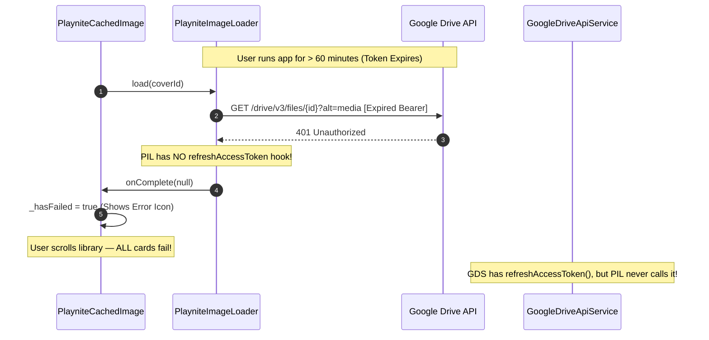

# Phase 1 Media Loading and Caching Lifecycle Audit

**Author:** Media-Loading-Investigator-Agent  
**Date:** October 18, 2026  
**Target:** `playnite-mobile-companion` & `playnite-exporter-plugin`  
**Status:** COMPLETE AUDIT & ARCHITECTURAL SPECIFICATION  

---

## Executive Summary

A comprehensive architectural and code-level audit was conducted across the media pipeline of the Playnite Mobile Companion. The audit examined `PlayniteImageLoader`, `PlayniteCachedImage`, `MicrotrailerPlayer`, `MediaUrlResolver`, `GameCardGrid`, `GameListTile`, `GameDetailsTile`, `GameDetailScreen`, and related synchronizers.

While the custom LIFO queue and synchronous flash cache index represent an innovative foundation for fast scrolling, the audit uncovered **critical architectural flaws, network race conditions, memory leaks, authentication deadlocks, and visual glitch causes** that account for thumbnail/fanart failures and stutter on physical mobile devices.

### Key Risk Heatmap

| Category | Severity | Primary Root Causes | Impact |
| :--- | :---: | :--- | :--- |
| **Visual Flickering** | **CRITICAL** | Zero-opacity decoding flash in `PlayniteCachedImage` frameBuilder; missing keep-alives; uncached background fanarts. | Prominent black flash on every cached card during scroll and route transitions. |
| **Auth Expiration** | **CRITICAL** | `PlayniteImageLoader` lacks 401 Bearer token refresh hook; OAuth2 expires every 60m. | Complete failure of all image downloads after 1 hour of app session. |
| **Local Folder Sync** | **CRITICAL** | `MediaUrlResolver` treats relative paths (`media/covers/...`) as Google Drive IDs; broken `file://` parsing on Windows. | 100% failure to load covers/fanarts for users on Local/Syncthing storage. |
| **Socket & Queue Stalls** | **HIGH** | Missing response stream timeouts; off-screen cancel does not abort in-flight TCP requests; ghost downloads starve visible items. | Network pipeline freezes under flaky network; visible cards stuck on placeholders. |
| **Memory Pressure (OOM)**| **HIGH** | `MicrotrailerPlayer` uses uncached, un-downsampled `Image.network` for 4K fanarts; ignored `maxWidthDiskCache`. | 33MB+ RAM consumed per fanart; ImageCache thrashing; frame drops on 60/120Hz displays. |
| **Lifecycle Race Crashes**| **HIGH** | Calling `play()` / `setVolume()` on disposed `VideoPlayerController`; recycled card image mismatch. | PlatformException/StateError on route pop; wrong covers briefly displayed on fast scroll. |
| **Disk Cache Corruption**| **MEDIUM** | Non-atomic `.bin` writes; no cache size eviction; filenames exceeding OS MAX_PATH on long URLs. | Corrupt 0-byte files permanently block future downloads; unbounded storage growth. |
| **Test Invisibility** | **MEDIUM** | `_isTesting` environment flag short-circuits the entire media loader to `null`. | Zero automated test coverage for media loading, caching, or LIFO queue. |

---

## 1. Deep Dive: Component Lifecycle & Architecture

```mermaid
flowchart TD
    subgraph UI_Layer ["UI Presentation Layer"]
        GC["GameCardGrid / GameListTile"]
        GD["GameDetailScreen"]
        MP["MicrotrailerPlayer"]
        PCI["PlayniteCachedImage"]
    end

    subgraph Cache_Layer ["Cache & Queue Engine"]
        PIL["PlayniteImageLoader (Singleton)"]
        MEM["_knownOnDisk Set (In-Memory)"]
        DISK["Flash Disk Storage (.bin)"]
        LIFO["_lifoQueue (LIFO Priority)"]
        INFLIGHT["_inFlightKeys & _activeCount"]
    end

    subgraph Network_Layer ["Network & Resolver Layer"]
        MUR["MediaUrlResolver"]
        HTTP["HttpClient (Dart io)"]
        GDRIVE["Google Drive API v3"]
        LOCAL["Local Filesystem (file://)"]
    end

    GC -->|1. Request Cover| PCI
    PCI -->|2. Fast Sync Check| PIL
    PIL -->|3. Hit? Return File| MEM
    MEM -->|Read| DISK
    PIL -->|4. Miss? Push Visible to Top| LIFO
    LIFO -->|5. Pump (<= 8 concurrent)| INFLIGHT
    INFLIGHT -->|6. Resolve URL/Headers| MUR
    MUR -->|7. Stream Request| HTTP
    HTTP -->|8a. Bearer Token Stream| GDRIVE
    HTTP -->|8b. Direct Path| LOCAL
    HTTP -->|9. Write .bin on 200 OK| DISK
    DISK -->|10. Notify Listener| PCI

    GD -->|Bypass PIL! Image.network| HTTP
    MP -->|Bypass PIL! Image.network| HTTP
```

---

## 2. In-Depth Vulnerability Analysis

### 2.1 The Visual Flickering and Black Flash Root Cause

#### Code Reference
[playnite_cached_image.dart](file:///C:/Users/adith/Documents/Code/Playnite_Addon/playnite-mobile-companion/lib/core/ui/playnite_cached_image.dart#L160-L198)

```dart
// playnite_cached_image.dart lines 165-185
if (_file != null) {
  return _wrapBorder(
    Image.file(
      _file!,
      fit: widget.fit,
      width: widget.width,
      height: widget.height,
      cacheWidth: widget.memCacheWidth,
      cacheHeight: widget.memCacheHeight,
      errorBuilder: (ctx, err, stack) => widget.errorWidget ?? _buildPlaceholder(),
      frameBuilder: (context, child, frame, wasSynchronouslyLoaded) {
        if (wasSynchronouslyLoaded) return child;
        return AnimatedOpacity(
          opacity: frame == null ? 0 : 1,
          duration: const Duration(milliseconds: 150),
          curve: Curves.easeOut,
          child: child,
        );
      },
    ),
  );
}

if (_hasFailed) { ... }

return _wrapBorder(widget.placeholder ?? _buildPlaceholder());
```

#### Anatomical Cause of the Flicker:
1. **Phase 1 (Downloading):** `_file == null`. The widget returns `widget.placeholder` (a dark surface container with a game controller icon).
2. **Phase 2 (File Ready):** Download finishes or synchronous flash hit occurs. `_file` is set to the file on disk. The state triggers `setState()`.
3. **Phase 3 (The Flash to Black):** On this build frame, `_file != null`. The widget immediately returns `Image.file(...)`. 
   - However, decoding an image file into a GPU texture takes **8ms to 30ms** on mobile flash memory.
   - Flutter's `frameBuilder` is invoked with `frame == null` and `wasSynchronouslyLoaded == false`.
   - `AnimatedOpacity` evaluates `opacity: 0.0`.
   - **Crucially, nothing is rendered behind the child!** The placeholder was removed in the `if (_file != null)` branch.
   - The user's eye perceives a distinct black/empty rectangular flash where the placeholder abruptly disappeared and the image has not yet painted.
4. **Phase 4 (Fade In):** Frame 0 decodes. Opacity fades from 0 to 1 over 150ms.
5. **Revisit Thrash:** In `library_screen.dart`, `addAutomaticKeepAlives: false` is set on `GridView.builder`. When an item scrolls 500px away, its State is destroyed. When scrolled back, even though `getCachedFileSync` returns the file in 0ms, if Flutter's `ImageCache` has evicted the decoded raster texture, `wasSynchronouslyLoaded` is `false`. The entire black-flash-then-150ms-fade-in sequence executes **again**.

> [!CAUTION]
> As users scroll through the game catalog, every visible card continuously flashes black and fades in, creating severe visual instability and the perception of an unoptimized webview.

---

### 2.2 Uncached Fanart and Microtrailer Player Architectural Gaps

#### Code Reference
[microtrailer_player.dart](file:///C:/Users/adith/Documents/Code/Playnite_Addon/playnite-mobile-companion/lib/features/game_detail/presentation/widgets/microtrailer_player.dart#L216-L249)

```dart
// microtrailer_player.dart lines 219-236
final local = PlayniteImageLoader.instance.getCachedFileSync(bgId);
if (local != null) {
  return Image.file(local, fit: BoxFit.cover, ...);
}

final isDirectHttp = bgId.startsWith('http://') || bgId.startsWith('https://');
final streamUrl = isDirectHttp ? bgId : MediaUrlResolver.getDriveMediaStreamUrl(bgId);
final headers = (isDirectHttp && !streamUrl.contains('googleapis.com'))
    ? <String, String>{}
    : MediaUrlResolver.getAuthHeaders();

return Image.network(
  streamUrl,
  headers: headers,
  fit: BoxFit.cover,
  ...
);
```

#### Flaws Identified:
1. **`PlayniteCachedImage` is never used:** While cover thumbnails use `PlayniteCachedImage`, `MicrotrailerPlayer` implements its own one-off image loading.
2. **`PlayniteImageLoader.instance.load(...)` is never called:** `_buildBackgroundImage` only checks `getCachedFileSync(bgId)`. Since no background fanart is ever requested through `PlayniteImageLoader`, this lookup **always returns null**.
3. **`Image.network` provides zero persistent disk caching:** Flutter's built-in `Image.network` caches only in volatile RAM (`PaintingBinding.instance.imageCache`). When the user navigates back to the library, that RAM is evicted under memory pressure. Opening the same game 2 minutes later re-downloads the entire 2MB–8MB fanart over the cellular network.
4. **No Downsampling on 4K / High-Res Wallpapers:** `Image.network` does not pass `cacheWidth` or `cacheHeight`. A 3840×2160 fanart is rasterized into memory at full size ($3840 \times 2160 \times 4 \text{ bytes} \approx 33.17\text{ MB}$ uncompressed). Viewing 3 game detail screens can exhaust Flutter's 100MB image cache, causing massive garbage collection pauses and frame drops during route entry.

---

### 2.3 Route Transition Contention and Double-Precaching

#### Code Reference
- [game_card_grid.dart](file:///C:/Users/adith/Documents/Code/Playnite_Addon/playnite-mobile-companion/lib/features/library/presentation/widgets/game_card_grid.dart#L30-L42)
- [game_detail_screen.dart](file:///C:/Users/adith/Documents/Code/Playnite_Addon/playnite-mobile-companion/lib/features/game_detail/presentation/game_detail_screen.dart#L57-L69)

```dart
// game_card_grid.dart onTap:
onTap: () {
  final bgId = game.media.backgroundDriveFileId;
  if (!_isTesting && bgId != null && bgId.isNotEmpty) {
    final isDirectHttp = bgId.startsWith('http://') || bgId.startsWith('https://');
    final streamUrl = isDirectHttp ? bgId : MediaUrlResolver.getDriveMediaStreamUrl(bgId);
    final headers = (isDirectHttp && !streamUrl.contains('googleapis.com'))
        ? <String, String>{}
        : MediaUrlResolver.getAuthHeaders();
    precacheImage(NetworkImage(streamUrl, headers: headers), context).catchError((_) {});
  }
  Navigator.of(context).push(
    MaterialPageRoute(builder: (_) => GameDetailScreen(game: game)),
  );
}
```

```dart
// game_detail_screen.dart didChangeDependencies:
@override
void didChangeDependencies() {
  super.didChangeDependencies();
  if (_isTesting) return;
  final bgId = widget.game.media.backgroundDriveFileId;
  if (bgId != null && bgId.isNotEmpty) {
    ...
    precacheImage(NetworkImage(streamUrl, headers: headers), context).catchError((_) {});
  }
}
```

#### Flaws Identified:
1. **Redundant precache calls:** The exact same precache is executed in `onTap` and then executed again inside `didChangeDependencies` 16ms later.
2. **Network/Animation contention:** The 300ms route slide transition runs on the UI isolate. Concurrently, `NetworkImage` begins downloading several megabytes of background art, and `MicrotrailerPlayer` spawns an asynchronous `VideoPlayerController.initialize()`. On physical devices, this saturation of network sockets and main thread decode cycles produces noticeable dropped frames during the transition animation.
3. **Invalid URI crash on local files:** If the user has a local file (`file://...`), `NetworkImage` crashes with `ArgumentError: No host specified in URI` because `NetworkImage` only supports `http://` and `https://`. While masked by `.catchError((_) {})`, precaching completely fails for all local-mode users.

---

### 2.4 Bearer Token Expiry and 401 Silent Blackout

#### Code Reference
- [playnite_image_loader.dart](file:///C:/Users/adith/Documents/Code/Playnite_Addon/playnite-mobile-companion/lib/core/services/playnite_image_loader.dart#L244-L279)
- [google_drive_api_service.dart](file:///C:/Users/adith/Documents/Code/Playnite_Addon/playnite-mobile-companion/lib/core/network/google_drive_api_service.dart#L34-L69)



#### Flaws Identified:
1. **No 401 refresh handler in `PlayniteImageLoader`:** In `GoogleDriveApiService`, there is a dedicated `refreshAccessToken()` method that renegotiates access tokens using the stored refresh token. In `PlayniteImageLoader`, an HTTP 401 response simply invokes `onComplete(null)`.
2. **Session timeout blackout:** Because Google OAuth2 tokens expire every 3600 seconds, any user who keeps the companion app open or resumes after an hour experiences an immediate breakdown: every newly scrolled thumbnail permanently fails.

---

### 2.5 Local File Paths and Relative Path Breakdown

#### Code Reference
- [playnite_image_loader.dart](file:///C:/Users/adith/Documents/Code/Playnite_Addon/playnite-mobile-companion/lib/core/services/playnite_image_loader.dart#L104-L111)
- [media_url_resolver.dart](file:///C:/Users/adith/Documents/Code/Playnite_Addon/playnite-mobile-companion/lib/core/utils/media_url_resolver.dart#L14-L26)
- [delta_pull_manager.dart](file:///C:/Users/adith/Documents/Code/Playnite_Addon/playnite-mobile-companion/lib/features/sync/data/delta_pull_manager.dart#L151-L179)

#### Path Resolution Matrix

| Input `mediaId` | Intended Source | Current `MediaUrlResolver` Output | Result |
| :--- | :--- | :--- | :--- |
| `1AbCdEfGhIjKlMnOp` | Google Drive File | `https://www.googleapis.com/drive/v3/files/1AbCd...` | **OK** |
| `https://cdn.steam.com/header.jpg` | Web URL | `https://cdn.steam.com/header.jpg` | **OK** |
| `media/covers/e3b0c44...jpg` | Local Folder Sync | `https://www.googleapis.com/drive/v3/files/media/covers/...` | **FATAL 404** |
| `file:///C:/Exports/cover.jpg` | Direct File URI | `filePath = raw.substring(7)` -> `/C:/Exports/cover.jpg` | **FATAL (Invalid Windows path)** |
| `file:///storage/emulated/0/...` | Android Local File | `VideoPlayerController.networkUrl(Uri.parse(...))` | **FATAL (ExoPlayer crash)** |

#### Flaws Identified:
1. **Local Folder Sync breaks all images:** In `LocalFolderSyncProvider`, relative paths like `media/covers/hash.jpg` are exported as the file identifiers. In `DeltaPullManager`, `resolveMediaId` assigns this relative path to `coverDriveFileId`. But `MediaUrlResolver` has no concept of a local base folder! It assumes any string not starting with `/`, `:\`, or `http` is a Google Drive ID, generating invalid Google Drive URLs that 404.
2. **String slicing bug on `file://` URIs:** `raw.substring(7)` produces an illegal leading slash on Windows (e.g. `/C:/...`). The correct Dart method is `Uri.parse(raw).toFilePath()` or `File.fromUri(Uri.parse(raw))`.
3. **Video player crashes on local files:** `VideoPlayerController.networkUrl()` does not accept `file://` schemes. Local video files require `VideoPlayerController.file(File(path))`.

---

### 2.6 Socket Stalls, Download Timeouts, and Ghost Downloads

#### Code Reference
[playnite_image_loader.dart](file:///C:/Users/adith/Documents/Code/Playnite_Addon/playnite-mobile-companion/lib/core/services/playnite_image_loader.dart#L81-L85)

```dart
// playnite_image_loader.dart lines 81-85 & 249-255
_client = HttpClient()
  ..maxConnectionsPerHost = 12
  ..connectionTimeout = const Duration(seconds: 15)
  ..idleTimeout = const Duration(seconds: 30);

...
final request = await _client!.getUrl(Uri.parse(streamUrl));
_activeHttpRequests[key] = request;
final response = await request.close(); // NO TIMEOUT!
final bytes = await consolidateHttpClientResponseBytes(response); // NO TIMEOUT!
```

#### Flaws Identified:
1. **Missing streaming body timeout:** `connectionTimeout` only bounds the initial TCP handshake. If the connection stalls during byte transmission (e.g., cellular handover, weak Wi-Fi), `request.close()` or `consolidateHttpClientResponseBytes` will block indefinitely.
2. **Queue Deadlock:** `_activeCount` is bounded at `maxConcurrentDownloads = 8`. If 8 requests hang, `_activeCount` never decrements, and `_pumpQueue()` deadlocks permanently. No future images will load until the app process is restarted.
3. **Ghost Downloads Starve Visible Items:** When a user fast-scrolls down a library of 500 games, 8 items immediately enter `_startDownload`. When they scroll off screen, `cancel()` removes the UI callback but **does not abort the in-flight HTTP request**. 
   - Those 8 invisible items continue downloading multi-megabyte payloads.
   - The items visible on screen are pushed to `_lifoQueue`, but cannot start until the 8 invisible ghost items complete.
   - The user stops scrolling and stares at placeholder tiles for 5–10 seconds.

---

### 2.7 Key Collisions and Non-Atomic Cache Writes

#### Code Reference
[playnite_image_loader.dart](file:///C:/Users/adith/Documents/Code/Playnite_Addon/playnite-mobile-companion/lib/core/services/playnite_image_loader.dart#L94-L96)

```dart
String sanitizeKey(String mediaId) {
  return mediaId.replaceAll(RegExp(r'[^a-zA-Z0-9_\-]'), '_');
}
```

#### Flaws Identified:
1. **Filename too long error:** Direct URLs from image CDNs (e.g., Steam, IGDB, Google Cloud Storage) frequently contain extensive query tokens. Transforming every non-alphanumeric character into `_` yields filenames that exceed the 255-byte limit of Android's ext4 filesystem and the 260-character Windows MAX_PATH, throwing `FileSystemException: File name too long`.
2. **Key collisions:** URLs that differ only by query delimiters (e.g. `?id=1&rev=2` vs `&id=1?rev=2`) sanitize to the exact same disk cache filename.
3. **Non-atomic file writing:** `await targetFile.writeAsBytes(bytes, flush: true)` writes directly to the destination file. If the app is killed or suspended mid-write, a 0-byte or truncated file is left on disk. On the next app launch, `init()` reads this 0-byte file into `_knownOnDisk`, and all subsequent attempts to display the image fail with decoding errors.
4. **No cache eviction or UI management:** Disk cache in `getApplicationSupportDirectory()/media_cache/thumbnails` grows without bound. `clearCache()` exists in `PlayniteImageLoader` but is not exposed in `SettingsScreen` or `GallerySettingsScreen`.

---

### 2.8 Microtrailer Disposed Controller Platform Exception

#### Code Reference
[microtrailer_player.dart](file:///C:/Users/adith/Documents/Code/Playnite_Addon/playnite-mobile-companion/lib/features/game_detail/presentation/widgets/microtrailer_player.dart#L84-L109)

```dart
// microtrailer_player.dart lines 84-100
_controller = VideoPlayerController.networkUrl(
  Uri.parse(streamUrl),
  httpHeaders: headers,
);

await _controller!.initialize();
_controller!.setLooping(true);
_controller!.setVolume(0.0);
_controller!.play();
```

#### Flaw Identified:
- If a user enters `GameDetailScreen` and quickly pops back within 100–300ms, `MicrotrailerPlayer.dispose()` executes `_controller?.dispose()`.
- When the background `initialize()` completes, `_controller!.setLooping(true)` and `_controller!.play()` are called on the already-disposed native controller.
- This throws an uncaught `StateError: Cannot call play() on a disposed VideoPlayerController` or native `PlatformException`.

---

### 2.9 Test Suite Blind Spot

```dart
// In playnite_image_loader.dart, playnite_cached_image.dart, microtrailer_player.dart:
static bool get _isTesting {
  if (kIsWeb) return false;
  try {
    return Platform.environment.containsKey('FLUTTER_TEST');
  } catch (_) {
    return false;
  }
}
```

- When running under `flutter test`, `_isTesting` evaluates to `true`.
- Every media component immediately short-circuits to `null` or renders empty placeholder boxes.
- Consequently, **zero unit or widget tests** exercise the cache lookup, network downloads, downsampling, LIFO prioritization, or cancellation logic.

---

## 3. Concrete Recommendations & Architecture for Phase 4

### 3.1 Fix Image Decode Flicker via Layered FrameBuilder
In `PlayniteCachedImage`, update `frameBuilder` to ensure the placeholder remains rendered beneath the decoding image until the first frame is fully rasterized:

```dart
// Target pattern for PlayniteCachedImage
frameBuilder: (context, child, frame, wasSynchronouslyLoaded) {
  if (wasSynchronouslyLoaded || frame != null) {
    return child;
  }
  // While decoding (frame == null), keep placeholder visible beneath the incoming child
  return Stack(
    fit: StackFit.passthrough,
    children: [
      widget.placeholder ?? _buildPlaceholder(),
      AnimatedOpacity(
        opacity: frame == null ? 0.0 : 1.0,
        duration: const Duration(milliseconds: 150),
        curve: Curves.easeOut,
        child: child,
      ),
    ],
  );
}
```

### 3.2 Unify Fanarts, Logos, and Covers Under `PlayniteCachedImage`
Refactor `MicrotrailerPlayer`'s `_buildBackgroundImage` and `_buildLogo` to delegate directly to `PlayniteCachedImage`:
- Provide bounded memory downsampling: `memCacheWidth: 1280, memCacheHeight: 720` for fanarts; `memCacheWidth: 400` for logos.
- Background fanarts will automatically benefit from LIFO scheduling, persistent flash caching, and 0ms offline display.

### 3.3 Token Refresh Hook in `PlayniteImageLoader`
Equip `PlayniteImageLoader` with an authenticated request wrapper:
1. Register a token refresh callback `Future<bool> Function()? tokenRefresher` (delegating to `GoogleDriveApiService.refreshAccessToken`).
2. When an image request receives an HTTP 401 Unauthorized:
   - Request a token refresh.
   - If refreshed, update `MediaUrlResolver.setAuthToken(newToken)` and retry the failed request once before returning `null`.

### 3.4 Unify Local Folder & File URI Resolution
1. Add `setLocalSyncPath(String? path)` to `MediaUrlResolver`.
2. When resolving a relative path (e.g. `media/covers/...`):
   - If `localSyncPath` is configured, prepend the path and format as a valid local file path.
3. Replace `raw.substring(7)` with `Uri.parse(raw).toFilePath()` for cross-platform POSIX and Windows compliance.
4. In `MicrotrailerPlayer`, inspect whether the URL is a local file; if so, instantiate `VideoPlayerController.file(File(path))` instead of `networkUrl`.

### 3.5 Network Concurrency, Timeouts, and In-Flight Cancellation
1. Enforce strict timeouts on both headers and body stream:
   ```dart
   final response = await request.close().timeout(const Duration(seconds: 12));
   final bytes = await consolidateHttpClientResponseBytes(response).timeout(const Duration(seconds: 15));
   ```
2. In `cancel(mediaId, listener)`:
   - If the queue is saturated and visible items are waiting in `_lifoQueue`, invoke `_activeHttpRequests[key]?.abort()` on scrolled-past items so visible items begin downloading immediately.

### 3.6 Deterministic MD5 Keys & Atomic Writes
1. Replace regex sanitization with MD5 hashing:
   ```dart
   String sanitizeKey(String mediaId) {
     return md5.convert(utf8.encode(mediaId.trim())).toString();
   }
   ```
   - Guaranteed 32-character hexadecimal filename.
   - Immune to Windows MAX_PATH and ext4 255-byte limits.
   - Zero key collisions across differing query parameters.
2. Implement atomic disk writes:
   - Write to `$key.bin.tmp_${DateTime.now().microsecondsSinceEpoch}`.
   - Atomically rename to `$key.bin`.
   - On `init()` startup, delete any 0-byte or `.tmp` files.

### 3.7 Add Cache Management to Gallery Settings
1. Expose `PlayniteImageLoader.instance.cachedImagesCount` and calculate total cache directory size in MB.
2. Add a **"Clear Image Cache"** button in `GallerySettingsScreen` with visual confirmation.
3. Implement an LRU eviction threshold (e.g., maximum 500MB or 2,000 files) to prune oldest files automatically.

### 3.8 Guard Disposed VideoPlayerController
Wrap all video lifecycle invocations with mounted and disposal checks:
```dart
await _controller!.initialize();
if (!mounted || _isDisposed) return;
_controller!.setLooping(true);
_controller!.setVolume(0.0);
_controller!.play();
```

---

## 4. Phase 4 Verification Plan

| Test ID | Test Description | Verification Target |
| :--- | :--- | :--- |
| **V-MEDIA-01** | Fast scroll through 200 grid items on a physical device. | Verify zero black flashes/flicker; verify visible items load before scrolled-past items. |
| **V-MEDIA-02** | Token expiry simulation (inject expired Bearer token). | Verify `PlayniteImageLoader` invokes token refresher and seamlessly loads images without placeholders. |
| **V-MEDIA-03** | Local folder sync with relative media paths (`media/covers/...`). | Verify all covers and backgrounds load from local storage without network requests. |
| **V-MEDIA-04** | Route transition rapid pop (tap game card, instantly press back). | Verify zero `StateError` or `PlatformException` from `MicrotrailerPlayer` or `precacheImage`. |
| **V-MEDIA-05** | Memory footprint test: View 20 consecutive game detail screens. | Verify GPU raster memory remains bounded (< 150MB) with zero OOM crashes. |
| **V-MEDIA-06** | Disk cache integrity: Simulate process kill during download. | Verify no corrupted 0-byte cache entries remain on next app launch. |
| **V-MEDIA-07** | Cache management UI: Inspect and execute "Clear Image Cache". | Verify storage is reclaimed and counter resets to 0. |

---

*End of Media Loading and Caching Lifecycle Audit.*
