# Playnite Data Architecture & Extension Schema Specification

> **Version:** 1.0.0  
> **Author:** Recon-Agent (Phase 1: Discovery & Reverse-Engineering)  
> **Status:** Completed  
> **Target Audience:** Master Orchestrator, Discovery-Verifier-Agent, Architect-Agent (Phase 2), Builder Agents (Phase 3 & 4)

---

## 1. Executive Summary & Environment Layout

Playnite operates across two distinct file system roots in standard Windows installations:
1. **Application Binaries & Built-in Modules (`C:\Users\<user>\AppData\Local\Playnite`)**:
   - Contains core runtime executables (`Playnite.DesktopApp.exe`, `Playnite.FullscreenApp.exe`, `Toolbox.exe`), base runtime libraries (`Playnite.SDK.dll`, `LiteDB.dll`), CEF browser sub-processes, and default themes/templates.
   - Built-in extension directory (`Extensions/`) is structurally reserved for bundled libraries.
2. **User Data, Database, Addon Storage & Media Caches (`C:\Users\<user>\AppData\Roaming\Playnite`)**:
   - The authoritative data store. Holds all game database files (`library/*.db`), localized media files (`library/files/`), all third-party and community extensions (`Extensions/`), extension data repositories (`ExtensionsData/`), and rich extra media assets (`ExtraMetadata/`).

```
Playnite Storage Ecosystem
│
├── AppData\Local\Playnite\                       [Binaries & Runtime DLLs]
│   ├── Playnite.DesktopApp.exe
│   ├── Playnite.SDK.dll                          (Core SDK interfaces and models)
│   ├── LiteDB.dll                                (Embedded document database engine v4/v5)
│   └── Toolbox.exe
│
└── AppData\Roaming\Playnite\                     [User Data & State]
    ├── library\                                  (Core Playnite Library)
    │   ├── games.db                              (LiteDB database of all Game documents)
    │   ├── platforms.db, genres.db, tags.db...   (Secondary attribute databases)
    │   └── files\{GameGuid}\                     (Core game media: icons, covers, backgrounds)
    ├── Extensions\                               (Installed Extensions & Addons)
    │   └── {ExtensionFolder}\
    │       ├── extension.yaml                    (Extension manifest)
    │       └── {Module}.dll                      (Extension assembly code)
    ├── ExtensionsData\                           (Extension-Specific Data & JSON DBs)
    │   ├── {ExtensionGuid}\                      (Addon data directory mapped by Extension ID)
    │   │   ├── config.json
    │   │   └── {Feature}\{GameGuid}.json
    │   └── StoresData\                           (Shared store metadata caches)
    └── ExtraMetadata\                            (Rich Extra Media Cache)
        └── games\{GameGuid}\
            ├── Logo.png                          (High-res transparent game logo)
            ├── VideoMicrotrailer.mp4             (6-second gameplay loop)
            └── VideoTrailer.mp4                  (Full cinematic/gameplay trailer)
```

---

## 2. Core Playnite Library Architecture

### 2.1 Storage Engine: LiteDB
Playnite stores all game metadata and lookup tables in **LiteDB** (NoSQL embedded document database for .NET).
- **Format:** BSON-serialized documents stored within 8KB disk pages (`** This is a LiteDB file **`).
- **File Concurrency:** Open with exclusive lock by `Playnite.DesktopApp.exe`. External processes must access files via shared read streams or temporary file snapshots.
- **Collection Naming:** Singular entity name (`Game` inside `games.db`, `Platform` inside `platforms.db`, `GameSource` inside `sources.db`, `CompletionStatus` inside `completionstatuses.db`).

### 2.2 Primary Identifiers & Keys
Every game in Playnite possesses three distinct identifier dimensions:

| Field Name | Type | Description | Scope / Uniqueness | Example |
|---|---|---|---|---|
| `Id` (`_id`) | `Guid` (UUID v4) | Primary internal Playnite key. Immutable internal GUID assigned upon game creation. | Globally unique within Playnite library. Serves as folder name for media and addon records. | `008977a8-b225-4709-b96d-41ac44bef1c3` |
| `GameId` | `string` | Provider/Store specific identifier assigned by the importing library plugin. | Unique per provider (e.g. Steam AppID, Epic App Name, GOG ID). | `"921800"` (Steam) or `"af0facaba8e643c1b9850d0683ff56df"` (Epic) |
| `PluginId` | `Guid` | GUID of the library plugin responsible for synchronizing/managing this game. | Matches built-in Library Plugin IDs. | `cb91dfc9-b977-43bf-8e70-55f46e410fab` (Steam) |

#### Standard Library Provider GUIDs (`PluginId`):
- **Steam:** `cb91dfc9-b977-43bf-8e70-55f46e410fab`
- **Epic Games:** `00000002-dbd1-46c6-b5d0-b1ba559d10e4`
- **GOG Galaxy:** `00000001-ebb2-4eec-abcb-7c89937a42bb`
- **Xbox / Microsoft Store:** `7e4fbb5e-2ae3-48d4-8ba0-6b30e7a4e287`
- **EA app / Origin:** `85dd7072-2f20-4e76-a007-41035e390724`
- **Ubisoft Connect:** `c2f038e5-8b92-4877-91f1-da9094155fc5`
- **itch.io:** `b00343c9-e023-4254-939a-f20a1190e9ba`
- **Custom / Manual:** `00000000-0000-0000-0000-000000000000`

---

### 2.3 Core Game Schema (`Game` Entity in `library/games.db`)

```json
{
  "_id": { "$guid": "008977a8-b225-4709-b96d-41ac44bef1c3" },
  "Name": "Encased",
  "SortingName": "Encased",
  "GameId": "af0facaba8e643c1b9850d0683ff56df",
  "PluginId": { "$guid": "00000002-dbd1-46c6-b5d0-b1ba559d10e4" },
  "Description": "Encased is a modern single player sci-fi post-apocalyptic isometric role-playing game...",
  "Notes": null,
  "ReleaseDate": "2021-09-07",
  "Added": { "$date": "2022-12-24T03:04:02.000Z" },
  "Modified": { "$date": "2024-05-06T15:53:30.901Z" },
  "Playtime": { "$numberLong": "3645" },
  "PlayCount": { "$numberLong": "12" },
  "LastActivity": { "$date": "2024-05-06T15:53:30.901Z" },
  "RecentActivity": { "$date": "2024-05-06T15:53:30.901Z" },
  "IsInstalled": true,
  "InstallDirectory": "D:\\Games\\Encased",
  "InstallSize": { "$numberLong": "18456123456" },
  "Hidden": false,
  "Favorite": false,
  "EnableSystemHdr": false,
  "Version": "1.4.2",
  "UserScore": null,
  "CriticScore": 86,
  "CommunityScore": 80,
  "Icon": "008977a8-b225-4709-b96d-41ac44bef1c3\\2b651317-601f-47c9-a765-c2a8e80c12e3.ico",
  "CoverImage": "008977a8-b225-4709-b96d-41ac44bef1c3\\45c5f618-a3f8-45a8-89d4-0fc23447ea7d.jpg",
  "BackgroundImage": "008977a8-b225-4709-b96d-41ac44bef1c3\\dd29d322-6f6c-451f-8d24-66e2d38461f2.jpg",
  "SourceId": { "$guid": "7a13b65c-679c-4a95-8496-ba917172e698" },
  "CompletionStatusId": { "$guid": "89c768f0-3697-4384-b824-1a795a1bf27f" },
  "PlatformIds": [
    { "$guid": "b437e126-957c-4b23-9b3a-179529d4945c" }
  ],
  "GenreIds": [
    { "$guid": "cde429be-b10d-4ea3-a57e-dd25ba073420" }
  ],
  "DeveloperIds": [
    { "$guid": "139e1d24-1d87-45e6-8fa5-cf4fe83a4e85" }
  ],
  "PublisherIds": [
    { "$guid": "139e1d24-1d87-45e6-8fa5-cf4fe83a4e85" }
  ],
  "CategoryIds": [],
  "TagIds": [
    { "$guid": "59e4ec75-aaf3-4d9f-8c06-72956dc09287" }
  ],
  "FeatureIds": [
    { "$guid": "9d7a2a8e-27f0-4722-ade7-d954715dab6d" }
  ],
  "SeriesIds": [],
  "AgeRatingIds": [
    { "$guid": "9fbb566d-9e8d-4bc9-b4c9-88303b60b415" }
  ],
  "RegionIds": [],
  "Links": [
    {
      "Name": "Steam",
      "Url": "https://store.steampowered.com/app/921800"
    },
    {
      "Name": "Epic",
      "Url": "https://www.epicgames.com/store/en-US/p/encased"
    }
  ],
  "GameActions": [
    {
      "Name": "Play",
      "Type": 0,
      "Path": "Encased.exe",
      "Arguments": "",
      "WorkingDir": "",
      "IsHandledByPlugin": false
    }
  ],
  "Roms": []
}
```

#### Field Specifications & Types:

| Field | .NET Type | SQLite/JSON Representation | Notes |
|---|---|---|---|
| `Id` | `Guid` | `TEXT` (GUID string `00000000-0000-0000-0000-000000000000`) | Primary Key. Case-insensitive lowercase hex with hyphens. |
| `Name` | `string` | `TEXT` | Game display title. |
| `SortingName` | `string` | `TEXT` | Normalized title used for alphabetical sorting (omits 'The', etc.). |
| `GameId` | `string` | `TEXT` | External provider identifier. |
| `PluginId` | `Guid` | `TEXT` (GUID) | Identifies managing provider plugin. |
| `Description` | `string` | `TEXT` | HTML or plaintext summary of game. |
| `Notes` | `string` | `TEXT` | User custom private notes. |
| `Playtime` | `ulong` | `INTEGER` | Total elapsed playtime stored strictly in **seconds**. |
| `PlayCount` | `ulong` | `INTEGER` | Total times game process has executed. |
| `Added` | `DateTime?` | `TEXT` (ISO 8601 UTC) | Timestamp game was imported into library. |
| `Modified` | `DateTime?` | `TEXT` (ISO 8601 UTC) | Timestamp game metadata was last updated. |
| `LastActivity` | `DateTime?` | `TEXT` (ISO 8601 UTC) | Timestamp game session last concluded. |
| `RecentActivity`| `DateTime?` | `TEXT` (ISO 8601 UTC) | Used by Playnite for grouping in recent views. |
| `IsInstalled` | `bool` | `INTEGER` (0 or 1) | Installation state. |
| `InstallDirectory` | `string` | `TEXT` | Local root directory of executable. |
| `InstallSize` | `ulong?` | `INTEGER` | Disk space in bytes. |
| `Hidden` | `bool` | `INTEGER` (0 or 1) | Whether game is hidden from default views. |
| `Favorite` | `bool` | `INTEGER` (0 or 1) | Starred / pinned status. |
| `UserScore` | `int?` | `INTEGER` (0-100) | User-assigned score. |
| `CriticScore` | `int?` | `INTEGER` (0-100) | Metacritic or OpenCritic score. |
| `CommunityScore`| `int?` | `INTEGER` (0-100) | Steam/IGDB community percentage. |
| `CoverImage` | `string` | `TEXT` | Relative path to cover file in `library/files/`. |
| `BackgroundImage`| `string` | `TEXT` | Relative path to background file in `library/files/`. |
| `Icon` | `string` | `TEXT` | Relative path to icon file in `library/files/`. |
| `SourceId` | `Guid` | `TEXT` (GUID) | Foreign key to `library/sources.db`. |
| `CompletionStatusId`| `Guid` | `TEXT` (GUID) | Foreign key to `library/completionstatuses.db`. |
| `PlatformIds` | `List<Guid>` | `JSON array of GUIDs` | Foreign keys to `library/platforms.db`. |
| `GenreIds` | `List<Guid>` | `JSON array of GUIDs` | Foreign keys to `library/genres.db`. |
| `DeveloperIds` | `List<Guid>` | `JSON array of GUIDs` | Foreign keys to `library/companies.db`. |
| `PublisherIds` | `List<Guid>` | `JSON array of GUIDs` | Foreign keys to `library/companies.db`. |
| `CategoryIds` | `List<Guid>` | `JSON array of GUIDs` | Foreign keys to `library/categories.db`. |
| `TagIds` | `List<Guid>` | `JSON array of GUIDs` | Foreign keys to `library/tags.db`. |
| `FeatureIds` | `List<Guid>` | `JSON array of GUIDs` | Foreign keys to `library/features.db`. |
| `SeriesIds` | `List<Guid>` | `JSON array of GUIDs` | Foreign keys to `library/series.db`. |
| `Links` | `List<Link>` | `JSON array of objects` | `[{"Name": string, "Url": string}]`. |

---

### 2.4 Secondary Metadata Lookup Databases (`library/*.db`)

Each secondary database contains entity tables referenced by `Guid` from the main `Game` document.

| DB File | LiteDB Collection | Model Type | Key Schema Fields |
|---|---|---|---|
| `sources.db` | `GameSource` | Store / Source | `_id` (Guid), `Name` (e.g., "Steam", "GOG", "Epic", "Xbox", "EA app") |
| `completionstatuses.db` | `CompletionStatus` | Progression State | `_id` (Guid), `Name` ("Not Played", "Playing", "Played", "Beaten", "Completed", "On Hold", "Abandoned", "Plan to Play") |
| `platforms.db` | `Platform` | Hardware Platform | `_id` (Guid), `Name` ("PC (Windows)"), `SpecificationId` ("pc_windows") |
| `genres.db` | `Genre` | Game Genre | `_id` (Guid), `Name` ("Action", "RPG", "Adventure", "Strategy") |
| `tags.db` | `Tag` | User/Store Tags | `_id` (Guid), `Name` ("Singleplayer", "Atmospheric", "Great Soundtrack") |
| `companies.db` | `Company` | Devs & Publishers | `_id` (Guid), `Name` ("Valve", "CD Projekt RED", "FromSoftware") |
| `categories.db` | `Category` | User Categories | `_id` (Guid), `Name` ("Backlog", "VR Only", "Controller Supported") |
| `features.db` | `GameFeature` | Technical Features | `_id` (Guid), `Name` ("Cloud Saves", "Achievements", "Co-Op") |
| `series.db` | `Series` | Game Franchise | `_id` (Guid), `Name` ("The Witcher", "Dark Souls", "Fallout") |
| `ageratings.db` | `AgeRating` | Regulatory Rating | `_id` (Guid), `Name` ("PEGI 18", "ESRB Mature") |
| `regions.db` | `Region` | Geographic Region | `_id` (Guid), `Name` ("Europe", "USA", "Worldwide") |

---

### 2.5 Core Media Storage Architecture (`library/files/`)
When Playnite imports metadata, images are downloaded and saved in:
`C:\Users\<user>\AppData\Roaming\Playnite\library\files\{GameGuid}\`

#### Storage Path & Linking Convention:
- The `Game.CoverImage`, `Game.BackgroundImage`, and `Game.Icon` fields contain **relative paths** structured as:
  `"{GameGuid}\{AssetGuid}.{ext}"`
  *(e.g., `"008977a8-b225-4709-b96d-41ac44bef1c3\45c5f618-a3f8-45a8-89d4-0fc23447ea7d.jpg"`)*
- **Absolute Resolution Formula:**
  `AbsoluteFilePath = Path.Combine(PlayniteUserDataDir, "library", "files", Game.CoverImage)`
- **Supported Formats:**
  - Icons: `.ico`, `.png` (typically 32x32, 48x48, 256x256)
  - Covers: `.jpg`, `.png`, `.webp` (vertical aspect ratio typically 2:3 or 600x900)
  - Backgrounds: `.jpg`, `.png`, `.webp` (horizontal 16:9 1920x1080 or higher)

---

## 3. Installed Extensions & Directory Inventory

Playnite extensions reside in `C:\Users\<user>\AppData\Roaming\Playnite\Extensions\`.
Extension configuration and persistent databases reside in `C:\Users\<user>\AppData\Roaming\Playnite\ExtensionsData\`.

### 3.1 Complete Extension Mapping Matrix

| Extension Folder Name | Extension Manifest ID | Plugin / Storage GUID | Plugin Name | Version | Author | Type | ExtensionsData Storage Folder |
|---|---|---|---|---|---|---|---|
| `playnite-successstory-plugin` | `playnite-successstory-plugin` | `cebe6d32-8c46-4459-b993-5a5189d60788` | **SuccessStory** | 3.7.1 | Lacro59 | GenericPlugin | `cebe6d32-8c46-4459-b993-5a5189d60788` |
| `playnite-howlongtobeat-plugin` | `playnite-howlongtobeat-plugin` | `e08cd51f-9c9a-4ee3-a094-fde03b55492f` | **HowLongToBeat** | 3.11.2 | Lacro59 | GenericPlugin | `e08cd51f-9c9a-4ee3-a094-fde03b55492f` |
| `playnite-gameactivity-plugin` | `playnite-gameactivity-plugin` | `afbb1a0d-04a1-4d0c-9afa-c6e42ca855b4` | **GameActivity** | 3.5 | Lacro59 | GenericPlugin | `afbb1a0d-04a1-4d0c-9afa-c6e42ca855b4` |
| `ExtraMetadataLoader_705fdbca-e1fc-4004-b839-1d040b8b4429` | `ExtraMetadataLoader_705fdbca-e1fc-4004-b839-1d040b8b4429` | `705fdbca-e1fc-4004-b839-1d040b8b4429` | **Extra Metadata Loader** | 1.87 | darklinkpower | GenericPlugin | `705fdbca-e1fc-4004-b839-1d040b8b4429` & `ExtraMetadata/` |
| `playnite-checkdlc-plugin` | `playnite-checkdlc-plugin` | `bf78d9af-6e79-4c73-aca6-c23a11a485ae` | **CheckDlc** | 1.4.1 | Lacro59 | GenericPlugin | `bf78d9af-6e79-4c73-aca6-c23a11a485ae` |
| `playnite-playeractivities-plugin` | `playnite-playeractivities-plugin` | `3dbe2ee4-d6c9-4c09-b377-7a086369603e` | **PlayerActivities** | 1.1.1 | Lacro59 | GenericPlugin | `3dbe2ee4-d6c9-4c09-b377-7a086369603e` |
| `playnite-systemchecker-plugin` | `playnite-systemchecker-plugin` | `e248b230-6edf-41ea-a3c3-7861fa267263` | **SystemChecker** | 3.3.0 | Lacro59 | GenericPlugin | `e248b230-6edf-41ea-a3c3-7861fa267263` |
| `Review_Viewer_ca24e37a-76d9-49bf-89ab-d3cba4a54bd1` | `Review_Viewer_ca24e37a-76d9-49bf-89ab-d3cba4a54bd1` | `ca24e37a-76d9-49bf-89ab-d3cba4a54bd1` | **Steam Reviews Viewer** | 2.60 | darklinkpower | GenericPlugin | `ca24e37a-76d9-49bf-89ab-d3cba4a54bd1` |
| `SteamScreenshots_8e77fe31-5e62-41e2-8fa2-64844cfd5b6b` | `SteamScreenshots_8e77fe31-5e62-41e2-8fa2-64844cfd5b6b` | `8e77fe31-5e62-41e2-8fa2-64844cfd5b6b` | **Steam Screenshots Viewer** | 1.17 | darklinkpower | GenericPlugin | `8e77fe31-5e62-41e2-8fa2-64844cfd5b6b` |
| `felixkmh_DuplicateHider_Plugin` | `felixkmh_DuplicateHider_Plugin` | `382f8003-8ed0-4e47-ae93-05b43c9c6c32` | **DuplicateHider** | 3.14.5 | felixkmh | GenericPlugin | `382f8003-8ed0-4e47-ae93-05b43c9c6c32` |
| `felixkmh_Extras_Plugin` | `felixkmh_Extras_Plugin` | `d2039edd-78f5-47c5-b190-72afef560fbe` | **ThemeExtras** | 1.4.4 | felixkmh | GenericPlugin | `d2039edd-78f5-47c5-b190-72afef560fbe` |
| `felixkmh_StartPage_Plugin` | `felixkmh_StartPage_Plugin` | `a6a3dcf6-9bfe-426c-afb0-9f49409ae0c5` | **StartPage** | 2.14.1 | felixkmh | GenericPlugin | `a6a3dcf6-9bfe-426c-afb0-9f49409ae0c5` |
| `SparrowBrain_PlayNext` | `SparrowBrain_PlayNext` | `05234f92-39d3-4432-98c1-6f37a3e4b870` | **Play Next** | 1.6.2 | SparrowBrain | GenericPlugin | `05234f92-39d3-4432-98c1-6f37a3e4b870` |
| `SplashScreen_d8c4f435-2bd2-49d8-98f6-87b1d415934a` | `SplashScreen_d8c4f435-2bd2-49d8-98f6-87b1d415934a` | `d8c4f435-2bd2-49d8-98f6-87b1d415934a` | **Splash Screen** | 2.41 | darklinkpower | GenericPlugin | `d8c4f435-2bd2-49d8-98f6-87b1d415934a` |
| `Date_Importer_d0e7fb90-e74e-4955-b7bc-43a13339637e` | `Date_Importer_d0e7fb90-e74e-4955-b7bc-43a13339637e` | `eb9abc51-93a4-4db6-b2c9-159eb531b0f2` | **Purchase Date Importer** | 2.29 | darklinkpower | GenericPlugin | `eb9abc51-93a4-4db6-b2c9-159eb531b0f2` |
| `GOGSecondClassGameWatcher_2661ddac-946a-4fee-ba80-3ece762cb64b` | `GOGSecondClassGameWatcher_2661ddac-946a-4fee-ba80-3ece762cb64b` | `2661ddac-946a-4fee-ba80-3ece762cb64b` | **GOG Second Class Watcher** | 1.4 | darklinkpower | GenericPlugin | `2661ddac-946a-4fee-ba80-3ece762cb64b` |
| `FreeGameNotifications_e053a9fe-117f-40fd-ab46-0e09ac442ca9` | `FreeGameNotifications_e053a9fe-117f-40fd-ab46-0e09ac442ca9` | `e053a9fe-117f-40fd-ab46-0e09ac442ca9` | **Free Game Notifications** | 1.1.2 | darklinkpower | GenericPlugin | `e053a9fe-117f-40fd-ab46-0e09ac442ca9` |
| `GameRelations_a4c15d63-9ab4-4d96-9a0c-8f9b35d43a1f` | `GameRelations_a4c15d63-9ab4-4d96-9a0c-8f9b35d43a1f` | `a4c15d63-9ab4-4d96-9a0c-8f9b35d43a1f` | **Game Relations** | 1.10 | darklinkpower | GenericPlugin | `a4c15d63-9ab4-4d96-9a0c-8f9b35d43a1f` |
| `InstallButton_fd5887bb-2da2-4044-bea3-9896aea2f5b8` | `InstallButton_fd5887bb-2da2-4044-bea3-9896aea2f5b8` | `fd5887bb-2da2-4044-bea3-9896aea2f5b8` | **Install Button** | 1.3.1 | Azuravian | GenericPlugin | `fd5887bb-2da2-4044-bea3-9896aea2f5b8` |
| `ThemesDetailsViewToGridViewConverter_ef8a7226-eedc-478d-a506-92ee6c088aa3` | `ThemesDetailsViewToGridViewConverter_ef8a7226-eedc-478d-a506-92ee6c088aa3` | `ef8a7226-eedc-478d-a506-92ee6c088aa3` | **Details to Grid Converter** | 1.12 | darklinkpower | GenericPlugin | `ef8a7226-eedc-478d-a506-92ee6c088aa3` |
| `playnite-thememodifier-plugin` | `playnite-thememodifier-plugin` | `ec2f4013-17e6-428a-b8a9-5e34a3b80009` | **ThemeModifier** | 3.0.2 | Lacro59 | GenericPlugin | `ec2f4013-17e6-428a-b8a9-5e34a3b80009` |
| `PlayniteJsonExporter` | `PlayniteJsonExporter` | `14bd031a-a1ff-4754-a586-0b9c23a6f557` | **Playnite Json Exporter** | 4.0.0 | zachvlat | GenericPlugin | `14bd031a-a1ff-4754-a586-0b9c23a6f557` |
| `SteamLibrary_Builtin` | `SteamLibrary_Builtin` | `cb91dfc9-b977-43bf-8e70-55f46e410fab` | **Steam Library** | 2.47 | Playnite | GameLibrary | `cb91dfc9-b977-43bf-8e70-55f46e410fab` |
| `EpicGamesLibrary_Builtin` | `EpicGamesLibrary_Builtin` | `00000002-dbd1-46c6-b5d0-b1ba559d10e4` | **Epic Games Library** | 2.30 | Playnite | GameLibrary | `00000002-dbd1-46c6-b5d0-b1ba559d10e4` |
| `GogLibrary_Builtin` | `GogLibrary_Builtin` | `00000001-ebb2-4eec-abcb-7c89937a42bb` | **GOG Library** | 2.24 | Playnite | GameLibrary | `00000001-ebb2-4eec-abcb-7c89937a42bb` |
| `XboxLibrary_Builtin` | `XboxLibrary_Builtin` | `7e4fbb5e-2ae3-48d4-8ba0-6b30e7a4e287` | **Xbox Library** | 2.17 | Playnite | GameLibrary | `7e4fbb5e-2ae3-48d4-8ba0-6b30e7a4e287` |
| `UplayLibrary_Builtin` | `UplayLibrary_Builtin` | `c2f038e5-8b92-4877-91f1-da9094155fc5` | **Ubisoft Connect Library** | 2.9 | Playnite | GameLibrary | `c2f038e5-8b92-4877-91f1-da9094155fc5` |
| `ItchioLibrary_Builtin` | `ItchioLibrary_Builtin` | `b00343c9-e023-4254-939a-f20a1190e9ba` | **itch.io Library** | 2.8 | Playnite | GameLibrary | `b00343c9-e023-4254-939a-f20a1190e9ba` |
| `IGDBMetadata_Builtin` | `IGDBMetadata_Builtin` | `000001db-dbd1-46c6-b5d0-b1ba559d10e4` | **IGDB Metadata Provider** | 2.15 | Playnite | MetadataProvider | `000001db-dbd1-46c6-b5d0-b1ba559d10e4` |
| `Universal_Steam_Metadata` | `Universal_Steam_Metadata` | `f7da6eb0-17d7-497c-92fd-347050914954` | **Universal Steam Metadata** | 2.24 | Josef Nemec | MetadataProvider | `f7da6eb0-17d7-497c-92fd-347050914954` |
| `MobyGamesMetadata` | `MobyGamesMetadata` | `5d65902f-9bd9-44f9-b647-04f349622bb8` | **MobyGames Metadata** | 0.8 | Jeshibu | MetadataProvider | `5d65902f-9bd9-44f9-b647-04f349622bb8` |
| `GOGMetadata` | `GOGMetadata` | `fec6f5ee-4036-47e6-9ade-8e22dd63f93e` | **GOG Metadata** | 0.3 | Playnite | MetadataProvider | `fec6f5ee-4036-47e6-9ade-8e22dd63f93e` |
| `FriendlySetTime_1f05ed2e-f22d-45e0-8e81-16378a8464c7` | `FriendlySetTime_1f05ed2e-f22d-45e0-8e81-16378a8464c7` | `1f05ed2e-f22d-45e0-8e81-16378a8464c7` | **Friendly Set Playtime** | 1.1 | Lacro59 | GenericPlugin | None (UI utility) |
| `Log_Open_a755c30f-580a-491e-9584-6c5314f6e254` | `Log_Open_a755c30f-580a-491e-9584-6c5314f6e254` | `a755c30f-580a-491e-9584-6c5314f6e254` | **Log Open** | 2.12 | darklinkpower | ScriptExtension | `Log_Open_a755c30f-580a-491e-9584-6c5314f6e254` (empty) |
| `Nexus_Mods_Checker_ece2874c-be52-4a64-b178-ed379a042f85` | `Nexus_Mods_Checker_ece2874c-be52-4a64-b178-ed379a042f85` | `ece2874c-be52-4a64-b178-ed379a042f85` | **Nexus Mods checker** | 2.13 | darklinkpower | ScriptExtension | `Nexus_Mods_Checker_ece2874c-be52-4a64-b178-ed379a042f85` (empty) |
| `Riot` | `Riot` | `16f2847f-a4a4-4c6f-b61b-471faac1fce2` | **Riot Games Launcher Importer** | 0.2 | Playnite | GameLibrary | `16f2847f-a4a4-4c6f-b61b-471faac1fce2` (in DB) |

### 3.2 Residual & Auxiliary ExtensionsData Inventory (All 48 Folders Accounted)

The following 15 folders exist in `ExtensionsData/` as remnants of uninstalled plugins, client configuration stores, or empty script directories:

| ExtensionsData Folder | Associated Plugin / Function | File Count | Content / Description | Sync Architecture Action |
|---|---|---|---|---|
| `c6c8276f-91bf-48e5-a1d1-4bee0b493488` | **ScreenshotsVisualizer** (Lacro59) | 305 | `config.json` + 304 per-game `{GameGuid}.json` files | **Ignore / Whitelist Guard:** Uninstalled plugin; do not sync. |
| `5f2dfd12-5f13-46fe-bcdd-64eb53ace26a` | **GeForce NOW Importer** | 2 | `config.json`, `gfnDatabase.json` (590 KB catalog) | Ignore (cloud lookup table). |
| `134725de-cfcb-4474-849b-5d9c52babb75` | **FilterAgeRating** | 1 | `config.json` (age rating threshold map) | Ignore (UI filter setting). |
| `1f0c2867-28cf-4960-a2fc-869ee018664a` | **Property Ignorer / Bulk Metadata** | 2 | `config.json`, `data.json` | Ignore (client import filter). |
| `34c3178f-6e1d-4e27-8885-99d4f031b168` | **Game Title Normalizer** | 1 | `config.json` | Ignore (local preference). |
| `62d53f25-4e62-4f27-a49e-89e73cb1fd48` | **Store Web Auth Cache** | 2 | `config.json`, `cookies.bin` | Ignore / Do not sync (session cookies). |
| `aebe8b7c-6dc3-4a66-af31-e7375c6b5e9e` | **GOG Galaxy Client Settings** | 1 | `config.json` | Ignore (desktop client setting). |
| `e7c39fe7-bec1-4691-a818-b9ba1470ad21` | **Parental / Kiosk Lock Mode** | 1 | `config.json` (`PasswordSet: true`) | Ignore (desktop security config). |
| `f2db8fb1-4981-4dc4-b087-05c782215b72` | **Steam Tag Downloader** | 2 | `config.json`, `tagnames-english.json` | Ignore (tag dictionary). |
| `1b6aa61e-561c-47f4-9aed-15ffeb574cf4` | Residual Plugin Folder | 0 | Empty folder | Ignore. |
| `888ab97e-ea1b-40e5-a2da-ef917aee0603` | Residual Plugin Folder | 0 | Empty folder | Ignore. |
| `ed9c467f-5ab5-478f-a09f-936146188ad0` | Residual Plugin Folder | 0 | Empty folder | Ignore. |
| `EnableHDR_f9295ecb-cfdf-4599-93cb-1011a2ca68ae` | Residual HDR Script | 0 | Empty folder | Ignore. |
| `Log_Open_a755c30f-580a-491e-9584-6c5314f6e254` | Log Open Script Extension | 0 | Empty folder | Ignore. |
| `Nexus_Mods_Checker_ece2874c-be52-4a64-b178-ed379a042f85` | Nexus Mods Checker Script Extension | 0 | Empty folder | Ignore. |
| `StoresData` | Shared Store Account Caches | 712 | Steam global app list, user badges, DLC ownership | Documented in Section 4.11. |

---

## 4. Deep Addon Data Schemas

The following sections define the exact data representations, keys, types, and sample structures for every data-producing addon in `ExtensionsData/`.

### 4.1 SuccessStory (Achievements)
- **Plugin ID:** `cebe6d32-8c46-4459-b993-5a5189d60788`
- **Data File Path:** `ExtensionsData\cebe6d32-8c46-4459-b993-5a5189d60788\SuccessStory\{GameGuid}.json`
- **Game Key Mapping:** The JSON filename directly matches Playnite's `Game.Id` (`{Game.Id}.json`). The internal `Id` field also equals `Game.Id`.

#### Document Schema:
```json
{
  "Id": "008dd993-7507-4795-b1bb-862f9ce592be",
  "Name": "Sunless Sea",
  "GameExist": true,
  "DateLastRefresh": "2025-07-08T17:13:33.1942012Z",
  "IsManual": false,
  "IsIgnored": false,
  "ShowStats": true,
  "IsEmulators": false,
  "RAgameID": 0,
  "SourcesLink": {
    "Name": "Epic",
    "GameName": "Sunless Sea",
    "Url": "https://www.epicgames.com/store/en-US/achievements/sunless-sea"
  },
  "EstimateTime": {
    "DataCount": 0,
    "EstimateTimeMin": 0,
    "EstimateTimeMax": 0
  },
  "ItemsStats": [],
  "Items": [
    {
      "Name": "Sweet Sorrow",
      "ApiName": "ach_sweetheart",
      "Description": "Woo a sweetheart in London",
      "UrlUnlocked": "https://shared-static-prod.epicgames.com/epic-achievements/.../icons/9be394234b72ee9dfabc620dba4331f9",
      "UrlLocked": "https://shared-static-prod.epicgames.com/epic-achievements/.../icons/916d9d5c2fea23aade84311177150348",
      "DateUnlocked": "2021-10-17T10:16:42.384Z",
      "IsHidden": false,
      "Percent": 17.0,
      "GamerScore": 10.0,
      "CategoryOrder": 0,
      "CategoryIcon": "",
      "Category": "",
      "ParentCategory": "",
      "CategoryRpcs3": "",
      "CategoryShadPS4": "",
      "NoRarety": false,
      "Progression": {
        "Min": 0.0,
        "Max": 100.0,
        "Value": 100.0
      }
    }
  ]
}
```

#### Field Types & Semantics:
- `Id` (`string` / `Guid`): Target game GUID.
- `Items` (`array`): List of achievement objects:
  - `Name` (`string`): Display name of achievement.
  - `ApiName` (`string`): Internal identifier used by platform API.
  - `Description` (`string`): Unlock condition description.
  - `UrlUnlocked` (`string`): URL or relative path to unlocked icon.
  - `UrlLocked` (`string`): URL or relative path to grayscale/locked icon.
  - `DateUnlocked` (`string?` / `null`): ISO 8601 UTC timestamp when unlocked. Null if locked.
  - `Percent` (`float`): Global unlock percentage (0.0 - 100.0).
  - `GamerScore` (`float`): Points/Gamerscore awarded.
  - `IsHidden` (`bool`): Hidden/Secret achievement status.
  - `Progression` (`object?`): Current progress for tiered achievements (`Min`, `Max`, `Value`).

---

### 4.2 HowLongToBeat (Completion Time Estimates)
- **Plugin ID:** `e08cd51f-9c9a-4ee3-a094-fde03b55492f`
- **Data File Path:** `ExtensionsData\e08cd51f-9c9a-4ee3-a094-fde03b55492f\HowLongToBeat\{GameGuid}.json`
- **Game Key Mapping:** Filename equals `Game.Id`.

#### Document Schema:
```json
{
  "Id": "008977a8-b225-4709-b96d-41ac44bef1c3",
  "Name": "Encased",
  "DateLastRefresh": "2024-05-06T15:53:30Z",
  "Items": [
    {
      "Id": "70452",
      "Name": "Encased: A Sci-Fi Post-Apocalyptic RPG",
      "UrlImg": "https://howlongtobeat.com/games/70452_Encased_A_Sci-Fi_Post-Apocalyptic_RPG.jpg",
      "Url": "https://howlongtobeat.com/game/70452",
      "Platform": "Linux, PC",
      "GameType": 0,
      "IsVndb": false,
      "GameHltbData": {
        "MainStoryClassic": 93612,
        "MainStoryMedian": 93600,
        "MainStoryAverage": 94000,
        "MainStoryRushed": 75000,
        "MainStoryLeisure": 115000,
        "MainExtraClassic": 143145,
        "MainExtraMedian": 143000,
        "MainExtraAverage": 145000,
        "MainExtraRushed": 120000,
        "MainExtraLeisure": 180000,
        "CompletionistClassic": 242959,
        "CompletionistMedian": 240000,
        "CompletionistAverage": 245000,
        "CompletionistRushed": 200000,
        "CompletionistLeisure": 310000,
        "SoloClassic": 0,
        "CoOpClassic": 0,
        "VsClassic": 0
      }
    }
  ]
}
```

#### Field Types & Semantics:
- All duration fields in `GameHltbData` are stored strictly in **seconds**:
  - `MainStoryClassic` (e.g. 93612s = **26.0 hours**)
  - `MainExtraClassic` (e.g. 143145s = **39.8 hours**)
  - `CompletionistClassic` (e.g. 242959s = **67.5 hours**)
- Solo, CoOp, and Vs fields are populated for multiplayer or specialty titles.

---

### 4.3 GameActivity (Playtime Sessions & Tracking)
- **Plugin ID:** `afbb1a0d-04a1-4d0c-9afa-c6e42ca855b4`
- **Data File Path:** `ExtensionsData\afbb1a0d-04a1-4d0c-9afa-c6e42ca855b4\GameActivity\{GameGuid}.json`
- **Game Key Mapping:** Filename equals `Game.Id`.

#### Document Schema:
```json
{
  "Id": "1c69395a-1f9e-40e5-85f1-0ff9d3cf78aa",
  "Name": "Cyberpunk 2077",
  "GameExist": true,
  "DateLastRefresh": "2026-08-27T15:20:20.808Z",
  "SessionPlaytime": 15646,
  "Items": [
    {
      "SourceID": "b77710c7-1287-416e-9fa3-1c3fa310fb34",
      "PlatformIDs": [
        "b437e126-957c-4b23-9b3a-179529d4945c"
      ],
      "GameActionName": "Default action",
      "IdConfiguration": 0,
      "DateSession": "2026-07-05T08:44:29.828Z",
      "ElapsedSeconds": 10475,
      "Details": []
    },
    {
      "SourceID": "b77710c7-1287-416e-9fa3-1c3fa310fb34",
      "PlatformIDs": [
        "b437e126-957c-4b23-9b3a-179529d4945c"
      ],
      "GameActionName": "Default action",
      "IdConfiguration": 0,
      "DateSession": "2026-07-06T14:50:55.759Z",
      "ElapsedSeconds": 2994,
      "Details": []
    }
  ],
  "ItemsDetails": {
    "Items": {}
  }
}
```

#### Field Types & Semantics:
- `SessionPlaytime` (`long`): Total cumulative seconds logged across individual tracked sessions.
- `Items` (`array`): Granular session history:
  - `DateSession` (`string` ISO 8601): Exact session launch timestamp.
  - `ElapsedSeconds` (`long`): Session duration in seconds.
  - `SourceID` (`string` GUID): Store source at time of play.
  - `PlatformIDs` (`array` of GUIDs): Hardware platform at time of play.
  - `GameActionName` (`string`): Name of action executed.
  - `Details` (`array`): Optional hardware performance samples (FPS, GPU load, CPU temp) if enabled.

---

### 4.4 ExtraMetadataLoader (Video Trailers & Transparent Logos)
- **Plugin ID:** `705fdbca-e1fc-4004-b839-1d040b8b4429`
- **Data File Path:** `ExtensionsData\705fdbca-e1fc-4004-b839-1d040b8b4429\{GameGuid}_SteamAppDetails.json`
- **Media Storage Path:** `C:\Users\<user>\AppData\Roaming\Playnite\ExtraMetadata\games\{GameGuid}\`
- **Game Key Mapping:**
  - ExtraMetadata folders are named directly with `Game.Id` (`{GameGuid}/`).
  - AppDetails cache files are `{GameGuid}_SteamAppDetails.json`.

#### Exact ExtraMedia Assets:
Inside `ExtraMetadata\games\{GameGuid}\`:

| File Name | Format | Specifications / Measurements | Typical Size | Description |
|---|---|---|---|---|
| `Logo.png` | PNG (RGBA 32-bit transparent) | Dimensions: 600-640px width (variable aspect ratio, e.g. 606x148) | 20 KB - 250 KB | Official transparent game title logo for hero headers. |
| `VideoMicrotrailer.mp4` | MP4 (H.264 / AVC video only, no audio) | Res: **630x354** (16:9 SD), FPS: **59.94 fps**, Duration: **6.006 seconds**, Bitrate: ~2.6 Mbps | 1.5 MB - 2.5 MB | High-framerate looping 6-second micro-trailer preview. |
| `VideoTrailer.mp4` | MP4 (H.264 / AVC video + AAC stereo audio) | Res: **854x480** (480p) or 1080p, FPS: **59.94 fps**, Audio: 128 kbps stereo, Duration: 2 to 5 min | 25 MB - 60 MB | Full official game trailer. |

#### AppDetails Cache Schema (`{GameGuid}_SteamAppDetails.json`):
Caches the full Steam Web API Store response keyed by Steam AppID:
```json
{
  "921800": {
    "success": true,
    "data": {
      "type": "game",
      "name": "Encased: A Sci-Fi Post-Apocalyptic RPG",
      "steam_appid": 921800,
      "required_age": 0,
      "is_free": false,
      "controller_support": "full",
      "dlc": [1133090, 1209480, 1133130],
      "detailed_description": "...",
      "short_description": "...",
      "header_image": "https://shared.akamai.steamstatic.com/.../header.jpg",
      "capsule_image": "https://shared.akamai.steamstatic.com/.../capsule_231x87.jpg",
      "screenshots": [
        {
          "id": 0,
          "path_thumbnail": "https://shared.akamai.steamstatic.com/.../0000000308.600x338.jpg",
          "path_full": "https://shared.akamai.steamstatic.com/.../0000000308.1920x1080.jpg"
        }
      ],
      "movies": [
        {
          "id": 256852441,
          "name": "Release Trailer",
          "thumbnail": "https://shared.akamai.steamstatic.com/.../movie400.jpg",
          "webm": { "480": "...", "max": "..." },
          "mp4": { "480": "...", "max": "..." },
          "highlight": true
        }
      ]
    }
  }
}
```

---

### 4.5 CheckDlc (Downloadable Content Catalog)
- **Plugin ID:** `bf78d9af-6e79-4c73-aca6-c23a11a485ae`
- **Data File Path:** `ExtensionsData\bf78d9af-6e79-4c73-aca6-c23a11a485ae\CheckDlc\{GameGuid}.json`
- **Game Key Mapping:** Filename equals `Game.Id`.

#### Document Schema:
```json
{
  "Id": "008977a8-b225-4709-b96d-41ac44bef1c3",
  "Name": "Encased",
  "GameExist": true,
  "DateLastRefresh": "2024-05-06T15:53:30Z",
  "PriceNotification": false,
  "HasAllDlc": false,
  "IsManual": false,
  "AppId": 0,
  "Items": [
    {
      "DlcId": "66f25551fbd14ae4aa0960263c6a123f",
      "Name": "Encased - Run and Gun Kit",
      "Description": "Get more from your C.R.O.N.U.S. employment! Get unique boots and an exclusive energy pistol...",
      "Image": "https://cdn1.epicgames.com/salesEvent/.../EGS_EncasedRunandGunKit.jpg",
      "Link": "https://www.epicgames.com/store/en-US/p/encased--run-and-gun-kit",
      "IsOwned": false,
      "Price": "$3.99",
      "PriceBase": "$3.99"
    }
  ]
}
```

#### Field Types & Semantics:
- `Items` (`array`): DLC packages available for this game:
  - `DlcId` (`string`): Store DLC SKU / AppID.
  - `Name` (`string`): Name of the DLC.
  - `Description` (`string`): Description summary.
  - `Image` (`string`): Store capsule or artwork URL.
  - `Link` (`string`): Storefront purchase URL.
  - `IsOwned` (`bool`): Whether the user's account owns this DLC.
  - `Price` (`string`): Current purchase price string.
  - `PriceBase` (`string`): Undiscounted baseline price string.

---

### 4.6 Steam Reviews Viewer
- **Plugin ID:** `ca24e37a-76d9-49bf-89ab-d3cba4a54bd1`
- **Data File Path:** `ExtensionsData\ca24e37a-76d9-49bf-89ab-d3cba4a54bd1\reviewsDatabase.db`
- **Storage Format:** LiteDB collection `ReviewsResponseRecord_collection`.
- **Game Key Mapping:** `CacheKey` formatted as `"{SteamAppId}"` (string).

#### Record Schema (`ReviewsResponseRecord`):
```json
{
  "_id": 1,
  "CacheKey": "1003890",
  "CreatedAt": { "$date": "2026-08-15T12:00:00Z" },
  "Response": {
    "Success": 1,
    "QuerySummary": {
      "NumReviews": 20,
      "ReviewScore": 8,
      "ReviewScoreDesc": "Very Positive",
      "TotalPositive": 2840,
      "TotalNegative": 482,
      "TotalReviews": 3322
    },
    "Reviews": [
      {
        "Recommendationid": "14589210",
        "Author": {
          "Steamid": "76561198000000000",
          "NumGamesOwned": 215,
          "NumReviews": 14,
          "PlaytimeForever": 845,
          "PlaytimeLastTwoWeeks": 0
        },
        "Language": "english",
        "ReviewReview": "Superb narrative adventure game! Atmospheric and stylish.",
        "TimestampCreated": 1658421000,
        "TimestampUpdated": 1658421000,
        "VotedUp": true,
        "VotesUp": 45,
        "VotesFunny": 3,
        "WeightedVoteScore": 0.88,
        "CommentCount": 2,
        "SteamPurchase": true,
        "ReceivedForFree": false,
        "WrittenDuringEarlyAccess": false
      }
    ],
    "Cursor": "AoIIPw..."
  }
}
```

---

### 4.7 Steam Screenshots Viewer
- **Plugin ID:** `8e77fe31-5e62-41e2-8fa2-64844cfd5b6b`
- **Data File Path:** `ExtensionsData\8e77fe31-5e62-41e2-8fa2-64844cfd5b6b\appdetails\{SteamAppId}_appdetails.json`
- **Media Cache Path:** `ExtensionsData\8e77fe31-5e62-41e2-8fa2-64844cfd5b6b\ScreenshotsCache\{ScreenshotFilename}`
- **Game Key Mapping:** Keyed by Steam AppID (`Game.GameId`).

---

### 4.8 PlayerActivities
- **Plugin ID:** `3dbe2ee4-d6c9-4c09-b377-7a086369603e`
- **Data File Path:** `ExtensionsData\3dbe2ee4-d6c9-4c09-b377-7a086369603e\PlayerActivities\{GameGuid}.json`
- **Game Key Mapping:** Filename equals `Game.Id`.

#### Document Schema:
```json
{
  "Id": "1c69395a-1f9e-40e5-85f1-0ff9d3cf78aa",
  "Name": "Cyberpunk 2077",
  "GameExist": true,
  "DateLastRefresh": "2026-07-05T14:14:31.315Z",
  "Items": [
    {
      "DateActivity": "2026-06-08T14:48:07.684+05:30",
      "Type": 5,
      "Value": 0
    },
    {
      "DateActivity": "2026-06-09T14:11:42.964+05:30",
      "Type": 4,
      "Value": 5
    }
  ]
}
```
*Note: Activity types represent milestones: 4 = Achievement Unlocked, 5 = Game Started, 6 = Game Stopped.*

---

### 4.9 SystemChecker (Hardware System Requirements)
- **Plugin ID:** `e248b230-6edf-41ea-a3c3-7861fa267263`
- **Data File Path:** `ExtensionsData\e248b230-6edf-41ea-a3c3-7861fa267263\SystemChecker\{GameGuid}.json`
- **Game Key Mapping:** Filename equals `Game.Id`.

#### Document Schema:
```json
{
  "Id": "03d095f8-9012-420b-b5b5-486035a19854",
  "Name": "Sol Cesto",
  "GameExist": true,
  "DateLastRefresh": "2024-05-06T15:53:30Z",
  "Items": [
    {
      "IsMinimum": true,
      "Os": ["windows 7"],
      "Cpu": ["1 GHz processor"],
      "Gpu": ["DirectX 9 compatible"],
      "Ram": 1073741824.0,
      "RamUsage": "1 GB",
      "Storage": 314572800.0,
      "StorageUsage": "300.0 MB"
    },
    {
      "IsMinimum": false,
      "Os": ["windows 10"],
      "Cpu": ["2 GHz dual-core"],
      "Gpu": ["DirectX 11"],
      "Ram": 4294967296.0,
      "RamUsage": "4 GB",
      "Storage": 314572800.0,
      "StorageUsage": "300.0 MB"
    }
  ]
}
```

---

### 4.10 DuplicateHider & ThemeExtras Configuration
- **DuplicateHider (`382f8003-8ed0-4e47-ae93-05b43c9c6c32`)**:
  - `config.json` stores library prioritization for duplicate copies across stores:
    `Priorities: ["Steam", "GOG", "Epic", "Xbox", "Playnite", "EA app", "Ubisoft Connect", "Riot Games", "Indiegala", "itch.io"]`
  - Defines `HiddenTagId`, `RevealedTagId`, `HighPrioTagId`, `LowPrioTagId` used to tag alternate copies of multi-owned games.
- **ThemeExtras (`d2039edd-78f5-47c5-b190-72afef560fbe`)**:
  - `LinkIconCache/{domain}.ico`: Caches website favicons for game store links (328 cached icons found).
  - `Banners/`: Custom banner directory tree (`ByPlatformName`, `ByPlatformSpecId`, `ByPluginId`, `BySourceName`).

---

### 4.11 StoresData (Shared Store Cache)
- **Path:** `ExtensionsData\StoresData\`
- Shared by Lacro59 plugins (`CheckDlc`, `SuccessStory`, `GameActivity`) to track user ownership and library catalog:
  - `Steam_AppsList.json` (31.3 MB): Complete Steam global app catalog mapping AppID -> Name.
  - `SteamUserData.json` (11.5 MB): User account badges, inventory, and owned app list.
  - `Steam_GamesDlcsOwned.json`: List of all owned DLC AppIDs `[{"Id": "70"}, ...]`.
  - `Epic.json`, `EA.json`, `GOG.json`: Local account profile states and tokens.

---

## 5. Key Mapping & Entity Relationship Diagram

```mermaid
erDiagram
    PLAYNITE_GAME ||--o{ SUCCESS_STORY : "has achievements via Id"
    PLAYNITE_GAME ||--o{ HOWLONGTOBEAT : "has time estimates via Id"
    PLAYNITE_GAME ||--o{ GAME_ACTIVITY : "has play sessions via Id"
    PLAYNITE_GAME ||--o{ CHECK_DLC : "has DLC list via Id"
    PLAYNITE_GAME ||--o{ EXTRA_METADATA : "has videos and logos via Id"
    PLAYNITE_GAME ||--o{ SYSTEM_CHECKER : "has requirements via Id"
    PLAYNITE_GAME ||--o{ PLAYER_ACTIVITIES : "has milestone logs via Id"
    PLAYNITE_GAME ||--o{ STEAM_REVIEWS : "has reviews via GameId (Steam AppId)"
    PLAYNITE_GAME ||--o{ STEAM_SCREENSHOTS : "has screenshots via GameId (Steam AppId)"
    PLAYNITE_GAME }o--|| GAME_SOURCE : "references SourceId"
    PLAYNITE_GAME }o--|| COMPLETION_STATUS : "references CompletionStatusId"
    PLAYNITE_GAME }o--o{ PLATFORM : "references PlatformIds"

    PLAYNITE_GAME {
        Guid Id PK "Primary Playnite GUID"
        string GameId "External Store / AppID"
        Guid PluginId "Library Provider Plugin ID"
        string Name "Game Title"
        ulong Playtime "Total playtime in seconds"
        string CoverImage "Relative path to library/files"
        string BackgroundImage "Relative path to library/files"
        string Icon "Relative path to library/files"
    }

    EXTRA_METADATA {
        string GameGuid PK "ExtraMetadata/games/{Id}/"
        binary Logo_png "Transparent PNG logo"
        binary VideoMicrotrailer_mp4 "6-sec 60fps H.264 preview"
        binary VideoTrailer_mp4 "Full H.264/AAC trailer"
    }

    SUCCESS_STORY {
        string Id PK "ExtensionsData/{guid}/SuccessStory/{Id}.json"
        array Items "List of unlocked & locked achievements"
    }

    HOWLONGTOBEAT {
        string Id PK "ExtensionsData/{guid}/HowLongToBeat/{Id}.json"
        int MainStoryClassic "Main story seconds"
        int MainExtraClassic "Main + extra seconds"
        int CompletionistClassic "100% completionist seconds"
    }

    GAME_ACTIVITY {
        string Id PK "ExtensionsData/{guid}/GameActivity/{Id}.json"
        long SessionPlaytime "Total seconds"
        array Items "Session start timestamps and durations"
    }
```



---

## 6. Recommendations for Phase 2 (Delta-Sync Spec) & Phase 3 (Builder)

1. **Unified Partitioned Game Export Payload (`games/{GameGuid}.json`):**
   - The C# export plugin should aggregate Playnite Core Game attributes, SuccessStory achievements, HowLongToBeat estimates, GameActivity session summaries, and CheckDlc lists into a **single consolidated per-game JSON document**.
   - This prevents redundant round-trips to Google Drive and guarantees atomic state updates per game.
2. **Media Asset Delta-Sync Strategy:**
   - **Covers & Backgrounds:** Hash the file content (SHA-256) and upload to `media/covers/{hash}.webp` or `media/backgrounds/{hash}.webp`. This provides automatic content-addressable deduplication across duplicate games and edition variations.
   - **ExtraMetadata Microtrailers & Logos:**
     - Store microtrailers in `media/microtrailers/{GameGuid}.mp4`. Microtrailers are ~2 MB and stream instantly on mobile clients.
     - Store logos in `media/logos/{GameGuid}.png`.
     - Full trailers (`VideoTrailer.mp4`, 30-50 MB) should be flagged as optional or on-demand to protect mobile bandwidth and Google Drive storage limits.
3. **Database Concurrency Guarantee:**
   - To safely read Playnite LiteDB databases while Playnite is actively running, the plugin must either execute directly within the Playnite process runtime using `PlayniteApi.Database` (recommended for Phase 3 C# plugin) or use Win32 shared-read copy for external tools.
4. **Playtime Precision:**
   - Playtime across both Playnite Core (`Game.Playtime`) and HowLongToBeat / GameActivity is strictly in **seconds**. Mobile UI must parse seconds into hours and minutes (`H:MM` format).
