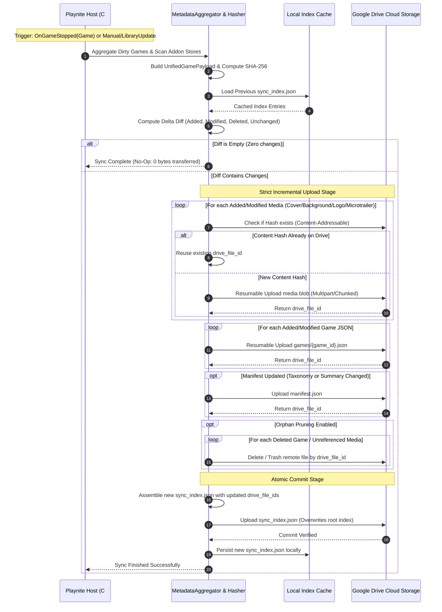
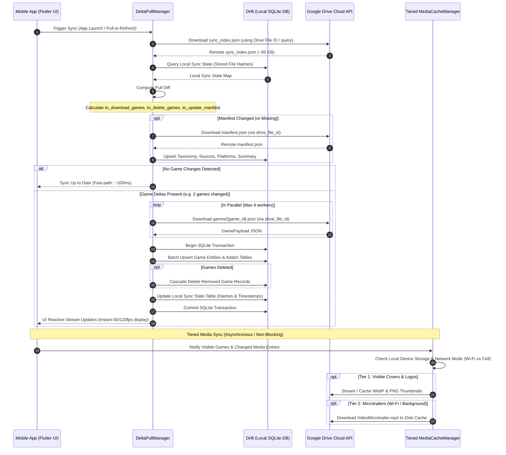

# Playnite Delta-Sync Protocol & Storage Contract Specification

> **Specification Version:** 1.0.0  
> **Author:** Architect-Agent (Phase 2: Lead Systems Architect)  
> **Audience:** Master Orchestrator, Spec-Verifier-Agent, Playnite-Plugin-Lead-Agent (Phase 3), Mobile-Lead-Agent (Phase 4)  
> **Status:** APPROVED FOR IMPLEMENTATION  

---

## 1. Executive Summary & Design Principles

The Playnite Delta-Sync ecosystem connects a desktop gaming library (managed by Playnite and third-party extensions on Windows) to a mobile companion app running on Android and iOS. This protocol establishes an **offline-first, strictly incremental, bandwidth-minimized delta synchronization protocol** backed by Google Drive as an intermediary cloud object store.

### 1.1 Core Guarantees & Non-Functional Requirements
1. **Atomic $O(1)$ Single-Game Delta:** When a user completes a play session for one game, only that individual game's JSON payload (`games/{game_id}.json`) and the root `sync_index.json` are generated and uploaded. Network transmission size is bounded to $\approx 10\text{ KB} - 120\text{ KB}$, completing in $<1\text{ second}$.
2. **Zero Redundant Transfers (Idempotence & Strict Incrementalism):** Every file in the sync ecosystem is content-addressed or cryptographically hashed using SHA-256. Files with matching hashes between the local and remote index are never re-uploaded or re-downloaded.
3. **Content-Addressable Media Deduplication:** Game covers and backgrounds are identified and stored by their content hash (`media/covers/{sha256}.webp`). Duplicate games across storefronts (e.g., Steam vs. Epic) or multi-edition variants automatically share storage references on Google Drive.
4. **Least-Privilege Cloud Security:** Google Drive authorization uses the scoped OAuth2 `drive.file` permission. The plugin and mobile app have access *only* to the files and folders they create; they have zero visibility or access to the user's personal Google Drive files.
5. **Read-Only Mobile Scope:** The mobile companion operates exclusively as a read-only consumer, inspector, search engine, and media viewer. It never modifies, writes, or deletes cloud state, preventing split-brain conflicts and concurrency race conditions. Server/Desktop is always authoritative.
6. **Graceful Degradation & Network Resiliency:** Both the exporter and mobile companion withstand connection interruptions, HTTP 429/503 rate-limiting via exponential backoff with jitter, and partial transfer states.

---

## 2. Cloud Storage Layout & Partitioning Strategy

All cloud assets reside within a single designated application root folder in the user's Google Drive (default: `PlayniteSync/`).

```
PlayniteSync/
│
├── sync_index.json                    # Root manifest & content-addressable index (Atomic Commit)
├── manifest.json                      # Global taxonomy, dictionaries, and library summary metrics
│
├── games/                             # Partitioned per-game unified metadata documents
│   ├── 008977a8-b225-4709-b96d-41ac44bef1c3.json
│   ├── 008dd993-7507-4795-b1bb-862f9ce592be.json
│   └── {game_id}.json
│
└── media/                             # Content-addressed & canonical media repository
    ├── covers/
    │   └── {sha256_hash}.webp         # Deduplicated vertical box art (WebP / JPEG)
    ├── backgrounds/
    │   └── {sha256_hash}.webp         # Deduplicated horizontal fanart (WebP / JPEG)
    ├── logos/
    │   └── {game_id}.png              # Transparent official game title logo (RGBA PNG)
    ├── microtrailers/
    │   └── {game_id}.mp4              # 6-second 60fps SD looping preview (~2 MB)
    └── trailers/                      # (Optional / On-Demand streaming only)
        └── {game_id}.mp4              # Full HD cinematic trailer (~40 MB)
```

### 2.1 Partitioning Rationale: Monolithic vs. Partitioned Storage

| Architectural Metric | Monolithic Archive (`library.zip` / `games.json`) | Partitioned per-game (`games/{id}.json`) |
|---|---|---|
| **1-Game Play Session Update** | Re-serializes and uploads all 1,429 games (~15–25 MB). | Serializes and uploads 1 game (~12 KB) + `sync_index.json` (~95 KB). |
| **Mobile Delta Ingestion** | Must parse 25 MB JSON into memory, causing UI freezes/GC spikes. | Fetches only dirty game JSONs; streams into SQLite via incremental batch transaction. |
| **Google Drive API Quotas** | Consumes high bandwidth; risks upload timeout on slow connections. | Minimal bandwidth; utilizes Drive's fast metadata & direct blob endpoints. |
| **Media Sync Flexibility** | Bundled or complex sidecar mappings. | Decoupled; media downloads are prioritized, backgrounded, or on-demand. |

---

## 3. Root Index Contract: `sync_index.json`

The root index file is the single authoritative source of truth for the entire synchronized library state. It maps every relative file path to its cryptographic SHA-256 hash, file size, modification timestamp, Google Drive `fileId`, MIME type, and category classification.

### 3.1 JSON Specification & Schema

```json
{
  "$schema": "https://json-schema.org/draft/2020-12/schema",
  "version": "1.0.0",
  "generator": "playnite-exporter-plugin",
  "client_version": "1.0.0",
  "generated_at_utc": "2026-10-15T21:00:00.000Z",
  "library_id": "e4b10b80-87a3-4a16-95fa-4993a4bc0321",
  "total_games": 1429,
  "total_entries": 4287,
  "total_size_bytes": 358249120,
  "entries": {
    "manifest.json": {
      "sha256": "8f434346648f6b96df89dda901c5176b10a6d83961dd3c1ac88b59b2dc327aa4",
      "size_bytes": 142850,
      "modified_utc": "2026-10-15T20:58:12.000Z",
      "drive_file_id": "1AbCdEfGhIjKlMnOpQrStUvWxYz012345",
      "mime_type": "application/json",
      "category": "manifest",
      "game_id": null
    },
    "games/008977a8-b225-4709-b96d-41ac44bef1c3.json": {
      "sha256": "4a5e1e8db2c3d4e5f6a7b8c9d0e1f2a3b4c5d6e7f8a9b0c1d2e3f4a5b6c7d8e9",
      "size_bytes": 14820,
      "modified_utc": "2026-10-15T20:55:00.000Z",
      "drive_file_id": "1BcDeFgHiJkLmNoPqRsTuVwXyZ0123456",
      "mime_type": "application/json",
      "category": "game_metadata",
      "game_id": "008977a8-b225-4709-b96d-41ac44bef1c3"
    },
    "media/covers/9a7d32c4b810e2f5a6b7c8d9e0f1a2b3c4d5e6f7a8b9c0d1e2f3a4b5c6d7e8f9.webp": {
      "sha256": "9a7d32c4b810e2f5a6b7c8d9e0f1a2b3c4d5e6f7a8b9c0d1e2f3a4b5c6d7e8f9",
      "size_bytes": 184520,
      "modified_utc": "2026-10-15T20:45:00.000Z",
      "drive_file_id": "1CdEfGhIjKlMnOpQrStUvWxYz01234567",
      "mime_type": "image/webp",
      "category": "cover",
      "game_id": "008977a8-b225-4709-b96d-41ac44bef1c3"
    },
    "media/logos/008977a8-b225-4709-b96d-41ac44bef1c3.png": {
      "sha256": "1234567890abcdef1234567890abcdef1234567890abcdef1234567890abcdef",
      "size_bytes": 48210,
      "modified_utc": "2026-10-15T20:45:00.000Z",
      "drive_file_id": "1DeFgHiJkLmNoPqRsTuVwXyZ012345678",
      "mime_type": "image/png",
      "category": "logo",
      "game_id": "008977a8-b225-4709-b96d-41ac44bef1c3"
    },
    "media/microtrailers/008977a8-b225-4709-b96d-41ac44bef1c3.mp4": {
      "sha256": "fedcba0987654321fedcba0987654321fedcba0987654321fedcba0987654321",
      "size_bytes": 2097152,
      "modified_utc": "2026-10-15T20:46:00.000Z",
      "drive_file_id": "1EfGhIjKlMnOpQrStUvWxYz0123456789",
      "mime_type": "video/mp4",
      "category": "microtrailer",
      "game_id": "008977a8-b225-4709-b96d-41ac44bef1c3"
    }
  }
}
```

### 3.2 Index Field Specification

| Key | Type | Description |
|---|---|---|
| `version` | `string` | Semantic version of index specification (`1.0.0`). |
| `generator` | `string` | Name of generating software component. |
| `client_version` | `string` | Version of the desktop exporter plugin. |
| `generated_at_utc` | `string` (ISO-8601) | Timestamp of index creation in UTC. |
| `library_id` | `string` (GUID) | Stable unique identifier for the user's Playnite library installation. |
| `total_games` | `integer` | Count of registered games in this snapshot. |
| `total_entries` | `integer` | Total number of mapped files in `entries`. |
| `total_size_bytes` | `integer` | Sum of all `size_bytes` in `entries`. |
| `entries` | `object` | Key-value dictionary. Key is the relative POSIX path (`games/{id}.json`). |
| `entries[path].sha256` | `string` | Lowercase hexadecimal 64-character SHA-256 hash. |
| `entries[path].size_bytes` | `integer` | Uncompressed file size in bytes. |
| `entries[path].modified_utc` | `string` (ISO-8601) | Last modified UTC timestamp of local file. |
| `entries[path].drive_file_id` | `string` | Google Drive File ID. Allows direct O(1) file retrieval on mobile without calling `files.list`. |
| `entries[path].mime_type` | `string` | Media/Content MIME type (`application/json`, `image/webp`, `image/png`, `video/mp4`). |
| `entries[path].category` | `string` (enum) | `manifest`, `game_metadata`, `cover`, `background`, `logo`, `microtrailer`, `trailer`. |
| `entries[path].game_id` | `string?` (GUID) | Target Playnite game GUID, or `null` for global files. |

---

## 4. Global Manifest Contract: `manifest.json`

To keep per-game JSON documents lean and eliminate redundant taxonomy string storage, the global taxonomy definitions, source stores, hardware platforms, genres, completion statuses, tags, and overall library summary metrics are externalized to `manifest.json`.

### 4.1 Schema & Structure

```json
{
  "$schema": "https://json-schema.org/draft/2020-12/schema",
  "version": "1.0.0",
  "generated_at_utc": "2026-10-15T21:00:00.000Z",
  "library_summary": {
    "total_games": 1429,
    "installed_games": 84,
    "favorite_games": 112,
    "hidden_games": 15,
    "total_playtime_seconds": 18452100,
    "total_play_count": 4820,
    "total_achievements_unlocked": 3894,
    "total_achievements_possible": 12850
  },
  "sources": [
    { "id": "cb91dfc9-b977-43bf-8e70-55f46e410fab", "name": "Steam", "icon_url": "media/sources/steam.png" },
    { "id": "00000002-dbd1-46c6-b5d0-b1ba559d10e4", "name": "Epic Games", "icon_url": "media/sources/epic.png" },
    { "id": "00000001-ebb2-4eec-abcb-7c89937a42bb", "name": "GOG", "icon_url": "media/sources/gog.png" }
  ],
  "completion_statuses": [
    { "id": "89c768f0-3697-4384-b824-1a795a1bf27f", "name": "Playing", "order": 1 },
    { "id": "2b3c4d5e-6f7a-8b9c-0d1e-2f3a4b5c6d7e", "name": "Completed", "order": 2 },
    { "id": "3c4d5e6f-7a8b-9c0d-1e2f-3a4b5c6d7e8f", "name": "Beaten", "order": 3 },
    { "id": "4d5e6f7a-8b9c-0d1e-2f3a-4b5c6d7e8f9a", "name": "Not Played", "order": 4 },
    { "id": "5e6f7a8b-9c0d-1e2f-3a4b-5c6d7e8f9a0b", "name": "Abandoned", "order": 5 }
  ],
  "platforms": [
    { "id": "b437e126-957c-4b23-9b3a-179529d4945c", "name": "PC (Windows)", "spec_id": "pc_windows" },
    { "id": "a1b2c3d4-e5f6-7a8b-9c0d-1e2f3a4b5c6d", "name": "PlayStation 5", "spec_id": "sony_playstation5" }
  ],
  "genres": [
    { "id": "cde429be-b10d-4ea3-a57e-dd25ba073420", "name": "Role-playing (RPG)" },
    { "id": "d1e2f3a4-b5c6-7d8e-9f0a-1b2c3d4e5f6a", "name": "Action" },
    { "id": "e2f3a4b5-c6d7-8e9f-0a1b-2c3d4e5f6a7b", "name": "Strategy" }
  ],
  "features": [
    { "id": "9d7a2a8e-27f0-4722-ade7-d954715dab6d", "name": "Achievements" },
    { "id": "f3a4b5c6-d7e8-9f0a-1b2c-3d4e5f6a7b8c", "name": "Cloud Saves" }
  ],
  "tags": [
    { "id": "59e4ec75-aaf3-4d9f-8c06-72956dc09287", "name": "Isometric" }
  ],
  "series": [
    { "id": "6a7b8c9d-0e1f-2a3b-4c5d-6e7f8a9b0c1d", "name": "The Witcher" }
  ],
  "active_addons": [
    { "id": "success_story", "name": "SuccessStory", "version": "3.7.1", "plugin_id": "cebe6d32-8c46-4459-b993-5a5189d60788", "is_enabled": true, "has_data": true },
    { "id": "how_long_to_beat", "name": "HowLongToBeat", "version": "3.11.2", "plugin_id": "e08cd51f-9c9a-4ee3-a094-fde03b55492f", "is_enabled": false, "has_data": true },
    { "id": "game_activity", "name": "GameActivity", "version": "3.5", "plugin_id": "afbb1a0d-04a1-4d0c-9afa-c6e42ca855b4", "is_enabled": true, "has_data": true },
    { "id": "extra_metadata", "name": "ExtraMetadataLoader", "version": "1.87", "plugin_id": "705fdbca-e1fc-4004-b839-1d040b8b4429", "is_enabled": true, "has_data": true },
    { "id": "check_dlc", "name": "CheckDlc", "version": "1.4.1", "plugin_id": "bf78d9af-6e79-4c73-aca6-c23a11a485ae", "is_enabled": true, "has_data": true },
    { "id": "system_checker", "name": "SystemChecker", "version": "3.3.0", "plugin_id": "e248b230-6edf-41ea-a3c3-7861fa267263", "is_enabled": true, "has_data": true }
  ]
}
```

### 4.2 Addon Lifecycle & Extensibility Guarantee (Adding/Removing Addons)

A core requirement of this ecosystem is that **adding, removing, disabling, or corrupting addons in Playnite must never break the sync protocol, corrupt cloud state, or crash the mobile companion**.

#### 1. Dynamic Discovery & Safe Extraction (Exporter Plugin)
- Addon extractors run within isolated `try/catch` error boundaries via an `IAddonDataExtractor` registry.
- If a plugin is uninstalled, disabled in Playnite settings, or its JSON files are corrupted, the extractor gracefully returns `null` or an empty payload. The export of the core game metadata and other healthy addons proceeds uninterrupted.
- Historical data retention: If an addon is disabled in Playnite (e.g. `HowLongToBeat` as discovered in Phase 1 QA), historical data on disk is still extracted if present and valid. If the user deletes the addon data completely, the exporter sets the addon payload to `null` or omits it on the next game modification.

#### 2. Forward/Backward Compatibility & Open Content Contract
- In `GAME_PAYLOAD_SCHEMA.json`, the `addons` container is modeled as a polymorphic, open dictionary (`additionalProperties: true`).
- Standard known addons have strict typed schemas (`success_story`, `how_long_to_beat`, `game_activity`, `check_dlc`, `extra_metadata`, `system_checker`, `steam_reviews`).
- Any new or third-party addon added in the future can write to `addons[custom_addon_key]` without requiring a bump to the core schema version.
- When an addon is removed by the user:
  - If a game is re-synced, the removed addon key is omitted from `addons`.
  - The mobile app's delta parser updates the local SQLite/Drift record, removing or clearing the corresponding child entity rows.

#### 3. Mobile UI Dynamic Feature Registry (`AddonSectionRegistry`)
- The Flutter mobile companion never hardcodes assumed addon presence.
- Each detail view tab or card registers against an `AddonSectionRegistry`.
- When rendering `GameDetailScreen`, the app inspects `game.addons.keys`:
  - If `success_story` is absent $\to$ the Achievements tab/card is completely hidden. Zero UI errors, zero empty blank states.
  - If a new, unrecognized addon key arrives $\to$ the app safely ignores it or exposes it in a collapsible "Additional Data" developer card without crashing.
  - The rest of the library, media player, search, and filter mechanics remain 100% operational.

---

## 5. Push Protocol: Playnite Plugin $\to$ Google Drive

The desktop exporter plugin is responsible for computing state differences, uploading new and modified files, pruning orphans, and committing the new root index.



### 5.1 Push Protocol Steps

#### Step 1: Change Detection & Aggregation
- **Event-Driven:** Playnite triggers `OnGameStopped` when a game exits. The aggregator identifies the target `Game` as "dirty".
- **Batch-Driven:** Manual sync or `OnLibraryUpdated` marks all modified games since the last export timestamp (`Game.Modified > LastSyncUtc`).
- For each dirty game, the aggregator queries Playnite's in-memory SDK collections and the whitelisted addon files (`SuccessStory`, `HowLongToBeat`, `GameActivity`, `CheckDlc`, `ExtraMetadataLoader`, `SystemChecker`) to construct the `UnifiedGamePayload`.

#### Step 2: Content Hashing & Local Diff Calculation
- The aggregator serializes the payload to UTF-8 JSON (with deterministic/sorted keys) and calculates its SHA-256 hash.
- It compares the current state against the local cache of `sync_index.json`:
  - **`Unchanged`**: SHA-256 matches existing index $\to$ **Skipped completely** ($0\text{ bytes}$).
  - **`Added`**: Game ID not present in index $\to$ Enqueued for upload.
  - **`Modified`**: Game ID present, but SHA-256 differs $\to$ Enqueued for upload/update.
  - **`Deleted`**: Game ID present in index, but removed from Playnite $\to$ Enqueued for pruning.
- Associated media files (covers, backgrounds, logos, microtrailers) are hashed and checked against the media index.

#### Step 3: Incremental Upload Execution
- Uploads are dispatched with controlled parallelism (max 4 concurrent HTTP connections) using `Google.Apis.Drive.v3`.
- **Media Content Deduplication:** If `media/covers/{hash}.webp` is already recorded in `sync_index.json` (e.g. from an alternate store copy), upload is bypassed and the existing `drive_file_id` is linked.
- **Resumable Chunked Uploads:** For video files (`VideoMicrotrailer.mp4` ~2 MB, `VideoTrailer.mp4` ~40 MB), `ResumableUpload` is utilized to allow recovery from network drops without restarting from byte 0.

#### Step 4: Orphan Pruning
- Files identified as `Deleted` (games removed from Playnite library or media unlinked by metadata updates) are deleted or moved to Google Drive Trash (`files.delete` or `files.update` with `trashed=true`).
- Unreferenced media files are verified before pruning: a media hash is deleted *only* if no other game in the new index references it.

#### Step 5: Atomic Commit
- The new `sync_index.json` is constructed containing the updated hashes, timestamps, and Google Drive `fileId` values for all items.
- The plugin uploads `sync_index.json` to Google Drive as the final operation.
- **Crash Safety:** If the upload process terminates at any point prior to this final step, Google Drive retains the previous valid `sync_index.json`. The mobile app will continue to read a consistent snapshot. The next desktop sync run will resume and re-diff against the previous index.

---

## 6. Pull Protocol: Google Drive $\to$ Flutter Mobile Companion

The mobile app reads the delta index, determines what local data is missing or outdated, pulls only the delta documents, applies them inside an SQLite/Drift database transaction, and lazily caches media according to user network policies.



### 6.1 Pull Protocol Steps

#### Step 1: Remote Index Retrieval
- The mobile app locates the root `sync_index.json` on Google Drive. To minimize API queries, the app caches the `drive_file_id` of `sync_index.json` in local secure storage.
- If the cached ID is invalid, it performs a single `files.list` query:
  `name = 'sync_index.json' and 'root' in parents and trashed = false`
- The index is fetched directly via Drive media download (`alt=media`). Payload is $\approx 50\text{ KB} - 150\text{ KB}$.

#### Step 2: Local SQLite Diff Engine
- The app queries its local `sync_meta` table in SQLite/Drift:
  `SELECT relative_path, sha256 FROM sync_meta;`
- It performs a set diff against `sync_index.json`:
  $$\text{GamesToDownload} = \{ p \in \text{RemoteEntries} \mid p \notin \text{LocalEntries} \lor \text{RemoteEntries}[p].\text{sha256} \ne \text{LocalEntries}[p].\text{sha256} \}$$
  $$\text{GamesToDelete} = \{ p \in \text{LocalEntries} \mid p \notin \text{RemoteEntries} \}$$

#### Step 3: Batch Ingestion & Transactional Integrity
- The app downloads only the files in $\text{GamesToDownload}$ using their respective `drive_file_id` properties in parallel (up to 4 concurrent HTTP streams).
- All downloaded game payloads are deserialized and passed to Drift.
- Drift executes a **single atomic transaction**:
  1. Upsert into `games` table.
  2. Clear and re-populate relational child rows (`game_platforms`, `game_genres`, `game_tags`, `game_links`).
  3. Upsert addon records (`achievements`, `play_sessions`, `how_long_to_beat`, `dlc_items`, `system_requirements`).
  4. Cascade delete records in $\text{GamesToDelete}$.
  5. Update `sync_meta` with the new file hashes and drive IDs.
- If any error occurs or the network drops mid-batch, the database transaction rolls back, leaving the local library in a known-good state. On the next sync attempt, the diff engine resumes remaining items.

#### Step 4: Tiered Media Synchronization Policy

To preserve device battery, cellular data quotas, and local flash storage, media downloads are partitioned into three distinct tiers:

```
┌────────────────────────────────────────────────────────────────────────┐
│                        TIERED MEDIA SYNC MATRIX                        │
├─────────┬───────────────────┬─────────────┬─────────────┬──────────────┤
│  Tier   │ Asset Type        │ Avg. Size   │ Sync Timing │ Network Mode │
├─────────┼───────────────────┼─────────────┼─────────────┼──────────────┤
│ Tier 1  │ Covers & Logos    │ 50-180 KB   │ On-Demand / │ Any (Cell /  │
│         │ (WebP / PNG)      │             │ Viewport    │ Wi-Fi)       │
├─────────┼───────────────────┼─────────────┼─────────────┼──────────────┤
│ Tier 2  │ Background Fanart │ 300-800 KB  │ Viewport /  │ Wi-Fi Only   │
│         │ & Microtrailers   │ 1.5-2.5 MB  │ Background  │ (Configurable│
│         │ (60fps MP4)       │             │ Prefetch    │ in Settings) │
├─────────┼───────────────────┼─────────────┼─────────────┼──────────────┤
│ Tier 3  │ Full Trailers     │ 25-60 MB    │ Explicit    │ User Tap     │
│         │ (HD 1080p MP4)    │             │ Streaming   │ (Never Auto- │
│         │                   │             │ Only        │ Downloaded)  │
└─────────┴───────────────────┴─────────────┴─────────────┴──────────────┘
```

1. **Tier 1 (Instant / Viewport Driven):**
   - Covers and title logos are loaded lazily as grid/list cards enter the viewport using `cached_network_image`.
   - The app constructs Google Drive direct media stream URLs using `drive_file_id` and the user's OAuth access token.
   - Successful downloads are cached in device storage up to a configurable budget (default: 500 MB LRU cache).
2. **Tier 2 (Background & Prefetch Driven):**
   - Microtrailers (`VideoMicrotrailer.mp4`) provide 6-second preview loops in the Game Detail screen.
   - Users can choose to:
     - Pre-cache microtrailers for Favorites / Recently Played over Wi-Fi.
     - Stream microtrailers on-demand when opening the Game Detail view.
3. **Tier 3 (Streaming Only):**
   - Full trailers (`VideoTrailer.mp4`) are never downloaded in bulk. If present, the video player streams the file via HTTP Range requests against Google Drive API, or launches the external storefront/YouTube link if available.

---

## 7. Conflict Resolution, Recovery & Network Failure Handling

### 7.1 Single-Writer / Read-Only Authority
Because the Playnite desktop extension is the **exclusive writer** and the mobile app is **strictly read-only**, traditional multi-master write conflicts (split-brain) are structurally impossible.
- **Rule:** Cloud state (Google Drive) is always authoritative over Mobile local state.
- **Rule:** Playnite Desktop state is always authoritative over Cloud state.

### 7.2 Network Interruption Scenarios

| Failure Point | Impact | Recovery Protocol |
|---|---|---|
| **Plugin crashes while uploading media** | Some media files uploaded to Drive; `sync_index.json` not updated. | On next sync, plugin computes SHA-256; finds existing media on Drive (via search or retry); completes remaining uploads; commits `sync_index.json`. Zero data loss. |
| **Plugin crashes while uploading game JSONs** | Some game JSONs uploaded; `sync_index.json` not updated. | Drive retains older `sync_index.json`. Mobile continues reading older valid state. On next sync, plugin re-evaluates dirty games, uploads remaining, commits index. |
| **Mobile loses connection while downloading index** | Incomplete index download. | Download is aborted; local Drift database remains unchanged. Error caught; UI displays "Sync offline - showing cached library". |
| **Mobile loses connection during game JSON batch** | Partial batch downloaded. | Drift transaction has not committed. Local DB rolls back. On next connection, diff engine detects which games are still missing and resumes downloading. |
| **Google Drive API HTTP 429 / 503 (Rate Limited)** | Request rejected by Google. | Both plugin and mobile implement Exponential Backoff with Jitter: Wait $T = 2^n + \text{rand}(0, 1000)\text{ ms}$ for $n \in \{1, 2, 3, 4, 5\}$. |

---

## 8. Theoretical & Practical Performance Benchmarks

Based on the verified census of 1,429 games from Phase 1:

### 8.1 Initial Full Sync (Cold Start)
- **Metadata:** 1,429 game JSONs $\times \approx 12\text{ KB} = 17.1\text{ MB}$.
- **Manifest & Index:** $\approx 250\text{ KB}$.
- **Covers (WebP):** 1,429 covers $\times \approx 120\text{ KB} = 171.4\text{ MB}$.
- **Logos (PNG):** 986 logos $\times \approx 50\text{ KB} = 49.3\text{ MB}$.
- **Microtrailers (Optional Tier 2):** 986 videos $\times \approx 2.0\text{ MB} = 1.97\text{ GB}$.
- **Total Initial Metadata & Core Art:** $\approx 238\text{ MB}$ (uploadable in $\approx 2 - 4\text{ minutes}$ on a typical 20 Mbps broadband uplink).

### 8.2 Daily Delta Sync (1 Game Played for 1 Hour)
- **Modified Assets:**
  - `games/{game_id}.json`: $\approx 14\text{ KB}$ (Playtime, LastPlayed, and GameActivity sessions updated).
  - `manifest.json`: $\approx 140\text{ KB}$ (Summary playtime and counter updated).
  - `sync_index.json`: $\approx 95\text{ KB}$ (Updated commit root).
  - Media: **0 bytes** (unchanged).
- **Total Data Transferred:** $\approx 249\text{ KB}$.
- **Network Duration:** $< 1.2\text{ seconds}$.
- **Google Drive API Calls:** 3 file updates (`files.update`).

---

## 9. Next Steps & Artifact References

- Unified Per-Game Schema: [`GAME_PAYLOAD_SCHEMA.json`](file:///C:/Users/adith/Documents/Code/Playnite_Addon/.orchestrator/SPECS/GAME_PAYLOAD_SCHEMA.json)
- Desktop Plugin Blueprint: [`TECHNICAL_BLUEPRINT_EXTENSION.md`](file:///C:/Users/adith/Documents/Code/Playnite_Addon/.orchestrator/SPECS/TECHNICAL_BLUEPRINT_EXTENSION.md)
- Mobile App Blueprint: [`TECHNICAL_BLUEPRINT_MOBILE.md`](file:///C:/Users/adith/Documents/Code/Playnite_Addon/.orchestrator/SPECS/TECHNICAL_BLUEPRINT_MOBILE.md)
