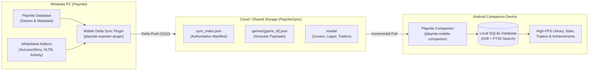

# Playnite Mobile Delta Sync

[](https://playnite.link/)
[](https://flutter.dev/)
[](https://dotnet.microsoft.com/)
[](https://flutter.dev/)
[](https://developers.google.com/drive)
[](LICENSE)

A high-performance, serverless, and offline-first mobile companion system for **[Playnite](https://playnite.link/)**. Keep your entire PC video game collection, rich metadata, achievements, play session timelines, and video micro-trailers seamlessly synced to your Android device via Google Drive or local storage with true **$O(\Delta)$ incremental delta synchronization**.

---

## The Idea Behind the Project

While Playnite is the premier open-source video game library manager for Windows PC, browsing and managing your library on mobile has traditionally suffered from two major limitations:
1. **The 24/7 Server Requirement:** Existing mobile solutions often require running a local web server or background daemon on your desktop PC at all times, along with complex network configuration, DDNS, and port forwarding. When your PC is powered off, your library is inaccessible.
2. **Massive Full-Export Overhead:** Simple cloud-sync solutions re-export and re-upload the entire library (often hundreds of megabytes or gigabytes) every time, leading to slow exports, bandwidth waste, and rate limits.

**Playnite Mobile Delta Sync solves this with an intelligent distributed architecture:**
- **Zero-Server Cloud Sync:** Uses your personal Google Drive as a serverless sync intermediary (or local storage/network shares). Your mobile device can sync anytime, anywhere—even when your PC is turned off.
- **Atomic $O(\Delta)$ Incremental Transfers:** When you finish playing a game or update metadata, only that single game's small JSON payload (~2 KB) and modified media are uploaded. A 2,000-game library syncs in **under 2 seconds**.
- **Offline-First & Fast:** The mobile companion downloads your library into a local SQLite database with full-text search (FTS5). The app is 100% functional offline, uses zero battery in the background, and features instant search.

---

## Parts of the Project

The project is split into two complementary components:

```
+-------------------------------------------------------------------------+
|                       Playnite Mobile Delta Sync                        |
+------------------------------------+------------------------------------+
|  1. Desktop Addon (Playnite)       |  2. Mobile Companion (Flutter)     |
|     `playnite-exporter-plugin`     |     `playnite-mobile-companion`    |
|                                    |                                    |
|  - C# / .NET Framework 4.6.2       |  - Flutter 3.x / Dart 3.x          |
|  - Hooks: OnGameStopped, Library   |  - Android (APK) & Cross-Platform  |
|  - Rich Addon Data Extraction      |  - Local SQLite (Drift / sqflite)  |
|  - Deterministic JSON & SHA-256    |  - Instant FTS5 Offline Search     |
|  - Google Drive REST API v3        |  - Video Micro-Trailer Player      |
|  - Native Progress Bar with ETA    |  - Global Statistics Dashboard     |
+------------------------------------+------------------------------------+
```

### 1. Playnite Desktop Exporter Addon (`playnite-exporter-plugin`)
- **SDK Lifecycle Hooks:** Automatically triggers single-game delta syncs the moment you exit a game (`OnGameStopped`), capturing playtime, new achievements, and session dates in real time.
- **Rich Addon Pipeline:** Extracts structured data from popular Playnite extensions:
  - **SuccessStory:** Unlocked and locked achievements, gamer scores, and icons.
  - **HowLongToBeat:** Main Story, Main + Extra, and Completionist target times.
  - **GameActivity:** Detailed play session history and timeline graphs.
  - **ExtraMetadataLoader:** High-resolution transparent game logos and looping video micro-trailers.
  - **CheckDlc:** DLC ownership and listings.
  - **SteamReviews & SystemChecker:** Hardware requirements and community review scores.
- **Content-Addressable Storage (CAS):** Deduplicates cover art and wallpapers by SHA-256 hash.
- **Two-Phase Atomic Commit:** Ensures the remote `sync_index.json` is committed last, preventing corrupt or partial states on network drops.

### 2. Flutter Mobile Companion (`playnite-mobile-companion`)
- **Strict Read-Only Design:** Clean viewer, tracker, and statistics dashboard without bloated game launchers or store API logins.
- **Smooth High-FPS Browsing:** Virtualized Grid, List, and Detail views with customizable card scaling.
- **Instant Search & Multi-Criteria Filtering:** Local SQLite/FTS5 filtering across platforms, genres, sources, completion statuses, tags, and review scores.
- **Game Detail View:** Hero header with transparent logos, auto-looping micro-trailers, achievement showcases, HLTB completion badges, and external links (Steam, IGDB, PCGamingWiki).
- **Global Statistics Dashboard:** Total games, cumulative playtime, completion rate donut charts, and platform breakdown graphs.
- **Built-in Demo Library:** Allows testing and exploring the app immediately without configuring cloud credentials.

---

## Architectural Flow



---

## Documentation & Detailed Guides

The project documentation is organized into focused sub-pages:

* [**Google Cloud Platform & Storage Setup Guide**](docs/setup-and-auth.md)  
  Step-by-step instructions for creating a Google Cloud project, configuring the `drive.file` OAuth consent screen, generating Desktop Client IDs, and setting up Local Folder / Google Drive for Desktop sync.

* [**Building from Source Guide**](docs/building.md)  
  Prerequisites, toolchain setup, and exact commands to compile and package both the `.pext` Playnite desktop extension and the Android `.apk` mobile installer.

* [**Installation & Usage Guide**](docs/installation-and-usage.md)  
  How to install the extension in Playnite, configure settings, run your first full export, install the mobile APK on Android, and explore all companion features.

* [**Architecture & Protocol Specification**](docs/architecture-and-specs.md)  
  Deep dive into the delta-sync protocol, deterministic JSON serialization, content-addressable media storage, supported addon schemas, and SQLite database design.

---

## Quick Start Overview

### 1. Set Up Storage
1. Configure a Google Cloud OAuth Client ID with the `drive.file` scope (see [Setup & Auth Guide](docs/setup-and-auth.md)), **OR** use **Local Folder Staging** with Google Drive for Desktop.

### 2. Install the Desktop Addon
1. Download or build [`MobileDeltaSyncExporter.pext`](docs/building.md).
2. Double-click the `.pext` file to install it into Playnite.
3. Open **Settings > Add-ons > Extension Settings > Mobile Delta Sync**.
4. Enter your Client ID / Secret (or select Local Folder) and click **Connect**.
5. Trigger **Main Menu > @Mobile Delta Sync > Force Full Re-Export & Upload** to create the initial cloud snapshot.

### 3. Install the Mobile App
1. Download or build [`playnite-mobile-companion.apk`](docs/building.md).
2. Install the APK on your Android device (via `adb install` or file transfer).
3. Open the app, go to **Sync Settings**, connect to your Google Drive folder (or tap **Load Demo Library**), and tap **Run Delta Sync Now**.

---

## Project Structure

```text
Playnite_Addon/
|-- .gitignore                             # Git ignore rules (secrets, build outputs, caches)
|-- DEPLOYMENT_GUIDE.md                    # Comprehensive deployment and operations manual
|-- README.md                              # Main project documentation
|-- docs/                                  # Modular GitHub documentation
|   |-- setup-and-auth.md                  # Google Cloud OAuth & storage setup guide
|   |-- building.md                        # Prerequisites & compilation commands (.pext / .apk)
|   |-- installation-and-usage.md          # Installation, first export & usage walkthrough
|   +-- architecture-and-specs.md          # Delta-sync protocol, data schema & architecture
|-- dist/                                  # Packaged distribution artifacts (git-ignored)
|   |-- MobileDeltaSyncExporter.pext       # Ready-to-install Playnite extension
|   +-- playnite-mobile-companion.apk      # Ready-to-install Android companion app
|-- playnite-exporter-plugin/              # Playnite C# .NET Desktop Addon
|   |-- PlayniteExporterPlugin.csproj      # .NET Framework 4.6.2 project file
|   |-- extension.yaml                     # Playnite plugin manifest
|   |-- Addons/                            # Whitelisted addon extractors (SuccessStory, HLTB, etc.)
|   |-- Common/                            # Deterministic serializer, hasher, progress estimator
|   |-- Configuration/                     # Settings, DPAPI token storage & WPF ViewModels
|   |-- Models/                            # Unified JSON data models & manifest contracts
|   |-- Services/                          # Metadata aggregator & ExportCoordinator sync engine
|   |-- Storage/                           # Google Drive REST client & Local Folder provider
|   +-- Views/                             # WPF / XAML SettingsView interface
|-- playnite-exporter-plugin.Tests/        # Automated test suite (30 unit & integration tests)
|   |-- PlayniteExporterPlugin.Tests.csproj
|   +-- ...                                # Unit tests verifying delta diff, CAS, and hashing
+-- playnite-mobile-companion/             # Flutter Mobile Companion App
    |-- pubspec.yaml                       # Flutter dependencies (Drift, SQLite, video_player)
    |-- lib/
    |   |-- core/                          # App theme, database helpers, and network clients
    |   +-- features/
    |       |-- library/                   # Virtualized Grid/List views, search & filter drawer
    |       |-- game_detail/               # Game detail hero header, micro-trailer & addon cards
    |       |-- stats/                     # Global statistics dashboard & charts
    |       +-- sync/                      # DeltaPullManager, settings & OAuth browser flow
    +-- test/                              # Automated Flutter test suites
```

---

## Security, Privacy & Zero Secrets

- **Least-Privilege Cloud Scope:** The extension and mobile app request only `https://www.googleapis.com/auth/drive.file`. The app can **only** access the files and folders it creates (e.g., `PlayniteSync`). It cannot see, read, or modify any other files in your personal Google Drive.
- **Local Credential Encryption:** On Windows, OAuth refresh tokens are encrypted using the native **Windows Data Protection API (DPAPI)** tied to your Windows user account.
- **Zero Third-Party Servers:** Communication occurs exclusively between your personal computer, your mobile phone, and Google's official REST API endpoints (`https://www.googleapis.com/drive/v3/`). There are no telemetry servers, analytics trackers, or intermediary relays.
- **No Secrets in Git:** All client credentials and tokens are entered dynamically by the user and are strictly ignored via `.gitignore`.

---

## Contributing

Contributions, bug reports, and feature suggestions are welcome!
1. Fork the repository.
2. Create a feature branch (`git checkout -b feature/amazing-feature`).
3. Ensure automated tests pass:
   - Desktop: `dotnet test playnite-exporter-plugin.Tests\PlayniteExporterPlugin.Tests.csproj`
   - Mobile: `flutter test` (in `playnite-mobile-companion`)
4. Commit your changes (`git commit -m 'Add amazing feature'`).
5. Push to the branch (`git push origin feature/amazing-feature`).
6. Open a Pull Request.

---

## License

This project is licensed under the MIT License — see the [LICENSE](LICENSE) file for details.
