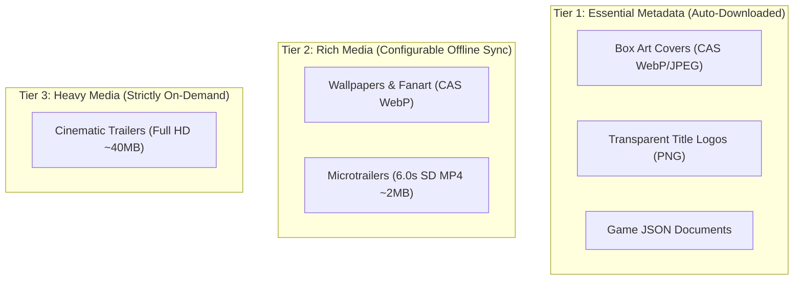
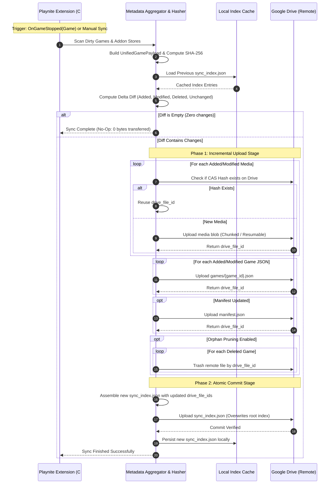

# Architecture & Delta-Sync Protocol Specification

This document details the architectural invariants, network protocols, data contracts, and storage schemas of **Playnite Mobile Delta Sync**. It serves as the single authoritative technical specification for both the Playnite desktop extension and the mobile companion app.

---

## Table of Contents
1. [Core Design Principles](#1-core-design-principles)
2. [Data Storage Topology](#2-data-storage-topology)
3. [Root Index Contract (`sync_index.json`)](#3-root-index-contract-sync_indexjson)
4. [Unified Game Payload Specification](#4-unified-game-payload-specification)
5. [Supported Playnite Addons & Fail-Soft Pipeline](#5-supported-playnite-addons--fail-soft-pipeline)
6. [Media Architecture & Streaming Tiers](#6-media-architecture--streaming-tiers)
7. [The Delta-Sync Protocol](#7-the-delta-sync-protocol)
   - [Desktop Push: Two-Phase Atomic Commit](#desktop-push-two-phase-atomic-commit)
   - [Mobile Pull: Incremental Delta Network Efficiency](#mobile-pull-incremental-delta-network-efficiency)
8. [Deterministic Serialization & Hashing](#8-deterministic-serialization--hashing)
9. [Mobile Storage & SQLite Schema (ADR 0001)](#9-mobile-storage--sqlite-schema-adr-0001)
10. [Packaging & Distribution Manifests](#10-packaging--distribution-manifests)

---

## 1. Core Design Principles

1. **Strict Incremental Delta Efficiency ($O(1)$ Overhead):** Modifying a single game's playtime or closing a session touches **only** that game's JSON payload (`games/{game_id}.json`) and the central `sync_index.json`. Full-library re-exports are never required for routine library updates.
2. **Read-Only Non-Invasive Scope:** The mobile companion is strictly a viewer, tracker, and statistics dashboard. It contains no game launchers, no execution binaries, and does not require direct store logins. Desktop Playnite remains the single source of truth.
3. **Least-Privilege Security:** Cloud sync uses Google's `drive.file` OAuth scope, restricting all access strictly to the dedicated application directory (`PlayniteSync`). The application has zero visibility or access to the user's personal Google Drive files.
4. **Fail-Soft Addon Resilience:** Whitelisted Playnite addons are extracted inside isolated `try/catch` error boundaries via an `IAddonDataExtractor` registry. Missing, disabled, or corrupted addons degrade gracefully without failing library export or crashing the mobile app.
5. **Offline-First:** All metadata and cached media are stored in local SQLite storage on the mobile device, providing instant offline querying, full-text searching, and dashboard analytics.

---

## 2. Data Storage Topology

Both Google Drive and Local Folder sync backends maintain an identical directory structure:

```text
PlayniteSync/
|-- manifest.json                 # Global library summary, taxonomy tables (platforms, genres, sources, tags)
|-- sync_index.json               # Authoritative manifest: relative paths, SHA-256 hashes, sizes, file IDs
|-- games/                        # Partitioned per-game unified metadata documents
|   |-- {game_guid_1}.json        # Unified per-game payload (core metadata + normalized addon stats)
|   |-- {game_guid_2}.json
|   +-- ...
+-- media/                        # Content-addressed & canonical media repository
    |-- covers/
    |   |-- {sha256_hash}.webp    # Content-Addressable Storage (CAS) cover images (or JPEG/PNG fallback)
    |   +-- ...
    |-- backgrounds/
    |   |-- {sha256_hash}.webp    # CAS background wallpapers
    |   +-- ...
    |-- logos/
    |   |-- {game_guid}.png       # Transparent game logo art
    |   +-- ...
    |-- microtrailers/
    |   |-- {game_guid}.mp4       # Standardized 6.0s 60fps SD looping preview (~2 MB)
    |   +-- ...
    +-- trailers/
        |-- {game_guid}.mp4       # Full HD cinematic trailer (~40 MB, on-demand streaming only)
        +-- ...
```

---

## 3. Root Index Contract (`sync_index.json`)

The root index file is the single authoritative source of truth for the entire synchronized library state. It maps every relative file path to its cryptographic SHA-256 hash, file size, modification timestamp, cloud `fileId`, MIME type, and category classification.

### 3.1 JSON Specification
```json
{
  "version": "1.0.0",
  "generator": "playnite-exporter-plugin",
  "client_version": "1.2.0",
  "generated_at_utc": "2026-10-20T10:00:00.000Z",
  "library_id": "e4b10b80-87a3-4a16-95fa-4993a4bc0321",
  "total_games": 1429,
  "total_entries": 4287,
  "total_size_bytes": 358249120,
  "entries": {
    "manifest.json": {
      "sha256": "8f434346648f6b96df89dda901c5176b10a6d83961dd3c1ac88b59b2dc327aa4",
      "size_bytes": 142850,
      "modified_utc": "2026-10-20T09:58:12.000Z",
      "drive_file_id": "1AbCdEfGhIjKlMnOpQrStUvWxYz012345",
      "mime_type": "application/json",
      "category": "manifest",
      "game_id": null
    },
    "games/008977a8-b225-4709-b96d-41ac44bef1c3.json": {
      "sha256": "4a5e1e8db2c3d4e5f6a7b8c9d0e1f2a3b4c5d6e7f8a9b0c1d2e3f4a5b6c7d8e9",
      "size_bytes": 14820,
      "modified_utc": "2026-10-20T09:55:00.000Z",
      "drive_file_id": "1BcDeFgHiJkLmNoPqRsTuVwXyZ0123456",
      "mime_type": "application/json",
      "category": "game_metadata",
      "game_id": "008977a8-b225-4709-b96d-41ac44bef1c3"
    },
    "media/covers/9a7d32c4b810e2f5a6b7c8d9e0f1a2b3c4d5e6f7a8b9c0d1e2f3a4b5c6d7e8f9.webp": {
      "sha256": "9a7d32c4b810e2f5a6b7c8d9e0f1a2b3c4d5e6f7a8b9c0d1e2f3a4b5c6d7e8f9",
      "size_bytes": 62310,
      "modified_utc": "2026-10-20T09:50:00.000Z",
      "drive_file_id": "1CdEfGhIjKlMnOpQrStUvWxYz01234567",
      "mime_type": "image/webp",
      "category": "cover",
      "game_id": "008977a8-b225-4709-b96d-41ac44bef1c3"
    }
  }
}
```

### 3.2 Canonical Category Classification Enum
Desktop and mobile strictly adhere to the following category strings:
- `manifest`: Library-wide summary and taxonomy mapping (`manifest.json`).
- `game_metadata`: Unified per-game payload (`games/{game_id}.json`).
- `cover`: Box art vertical imagery (`media/covers/*`).
- `background`: Wallpaper/fanart horizontal imagery (`media/backgrounds/*`).
- `logo`: Transparent PNG title logo (`media/logos/*`).
- `microtrailer`: Short looping video clip (`media/microtrailers/*`).
- `trailer`: Cinematic full-length trailer (`media/trailers/*`).
- `icon`: Platform, source, or achievement icon.

---

## 4. Unified Game Payload Specification

Every game in the library is serialized to `games/{game_id}.json`. The payload consolidates core Playnite metadata, taxonomy relationships, media asset references, DuplicateHider multi-copy grouping, and extensible third-party addon payloads.

### 4.1 Schema Contract
```json
{
  "schema_version": "1.0.0",
  "id": "008977a8-b225-4709-b96d-41ac44bef1c3",
  "game_id": "921800",
  "plugin_id": "cb91aec9-6843-41f9-a063-4d9942f7d000",
  "name": "Cyberpunk 2077",
  "sorting_name": "Cyberpunk 2077",
  "description": "Full HTML or plain-text description...",
  "notes": "Custom player notes...",
  "playtime_seconds": 218760,
  "play_count": 42,
  "added_utc": "2021-01-15T10:00:00Z",
  "modified_utc": "2026-10-20T09:30:00Z",
  "last_activity_utc": "2026-10-19T22:15:00Z",
  "release_date": "2020-12-10",
  "is_installed": true,
  "hidden": false,
  "favorite": true,
  "critic_score": 86,
  "community_score": 82,
  "user_score": 90,
  "platforms": [
    { "id": "4b54e3d6-4444-4f9e-9999-b13c8f900001", "name": "PC (Windows)" }
  ],
  "genres": [
    { "id": "11111111-2222-3333-4444-555555555555", "name": "Role-playing (RPG)" }
  ],
  "developers": ["CD PROJEKT RED"],
  "publishers": ["CD PROJEKT RED"],
  "tags": ["Cyberpunk", "Open World", "Sci-fi"],
  "links": [
    { "name": "Steam", "url": "https://store.steampowered.com/app/1091500" }
  ],
  "is_duplicate": false,
  "duplicate_group_id": null,
  "other_copies": [],
  "media": {
    "cover": {
      "path": "media/covers/9a7d32c4b810e2f5a6b7c8d9e0f1a2b3c4d5e6f7a8b9c0d1e2f3a4b5c6d7e8f9.webp",
      "sha256": "9a7d32c4b810e2f5a6b7c8d9e0f1a2b3c4d5e6f7a8b9c0d1e2f3a4b5c6d7e8f9",
      "drive_file_id": "1CdEfGhIjKlMnOpQrStUvWxYz01234567"
    },
    "background": {
      "path": "media/backgrounds/f1e2d3c4b5a697887766554433221100aabbccddeeff00112233445566778899.webp",
      "sha256": "f1e2d3c4b5a697887766554433221100aabbccddeeff00112233445566778899",
      "drive_file_id": "1DeFgHiJkLmNoPqRsTuVwXyZ012345678"
    },
    "logo": {
      "path": "media/logos/008977a8-b225-4709-b96d-41ac44bef1c3.png",
      "sha256": "1234567890abcdef1234567890abcdef1234567890abcdef1234567890abcdef",
      "drive_file_id": "1EfGhIjKlMnOpQrStUvWxYz0123456789"
    },
    "microtrailer": {
      "path": "media/microtrailers/008977a8-b225-4709-b96d-41ac44bef1c3.mp4",
      "sha256": "abcdef1234567890abcdef1234567890abcdef1234567890abcdef1234567890",
      "drive_file_id": "1FgHiJkLmNoPqRsTuVwXyZ01234567890",
      "duration_seconds": 6.0
    },
    "trailer": {
      "path": "media/trailers/008977a8-b225-4709-b96d-41ac44bef1c3.mp4",
      "drive_file_id": "1GhIjKlMnOpQrStUvWxYz012345678901",
      "web_url": "https://www.youtube.com/watch?v=qIcTM8WXFjk"
    }
  },
  "addons": {
    "success_story": { /* achievements payload */ },
    "how_long_to_beat": { /* HLTB completion times in seconds */ },
    "game_activity": { /* session history */ }
  }
}
```

### 4.2 DuplicateHider & Multi-Copy Fail-Soft Invariants
- `is_duplicate` (`boolean`, optional, default `false`): Flags whether this game is an alternate copy inside a duplicate group.
- `duplicate_group_id` (`string`, optional, nullable): Unique group identifier linking all editions/copies of this game together.
- `other_copies` (`array`, optional, default `[]`): Summary list of other editions owned across platforms (containing `id`, `name`, `platform_name`, `source_name`, `install_status`).
- **Resilience Invariant:** If DuplicateHider is not installed or the game has no duplicates, `is_duplicate` evaluates to `false`, `duplicate_group_id` is `null`, and `other_copies` is empty. The mobile UI renders a standard single-game card with zero duplicate badges and zero copy switchers.

---

## 5. Supported Playnite Addons & Fail-Soft Pipeline

The desktop plugin integrates with popular Playnite addons using an extensible whitelist architecture:

| Addon Key | Addon Name | Extracted Metadata | Companion Presentation |
| :--- | :--- | :--- | :--- |
| `success_story` | **SuccessStory** | Unlocked/locked achievements, gamer score, unlock timestamps, achievement icons | Achievements Tab & Progress Cards |
| `how_long_to_beat` | **HowLongToBeat** | Main Story, Main+Extra, and Completionist times (stored strictly in seconds) | Time to Beat Cards |
| `game_activity` | **GameActivity** | Session start/end timestamps, session duration, play count per date | Session Timeline & Play History Chart |
| `extra_metadata` | **ExtraMetadataLoader** | Transparent logos, 6.0s looping microtrailers, full trailers | Hero Header Video Player & Brand Logos |
| `check_dlc` | **CheckDlc** | DLC titles, store URLs, ownership flags | DLC Checklist Card |
| `system_checker` | **SystemChecker** | Minimum and recommended CPU, GPU, RAM, OS requirements | Hardware Requirements Tab |
| `steam_reviews` | **SteamReviews** | Review score text, positive review percentage | Review Score Badges |
| `steam_screenshots` | **SteamScreenshots** | User screenshot gallery URLs | Media Gallery Drawer |

### Dynamic Addon Extensibility Guarantee
- In the JSON contract, `addons` is an open container (`additionalProperties: true`).
- If an addon is not installed or has no data for a game:
  - The C# exporter emits `null` or omits that key.
  - The mobile `AddonSectionRegistry` skips rendering that card.
  - No database migration is triggered on mobile.
- Unknown future addons are rendered gracefully by a fallback generic viewer without schema modifications.

---

## 6. Media Architecture & Streaming Tiers

Media synchronization is organized into distinct **Offline Storage Tiers** to give users full control over mobile bandwidth and storage consumption.



### 6.1 Content-Addressable Storage (CAS) Deduplication
Image files are hashed with SHA-256 before storage. Identical images share the same filename (`media/covers/{sha256}.webp`), completely eliminating redundant duplicate uploads across storefronts (e.g. Steam vs GOG vs Epic copies of the same game).

### 6.2 Microtrailers vs Full Trailers
- **Microtrailer:** A lightweight, looping, muted video preview (standardized to 6.0s duration, SD 60fps MP4, ~2MB) stored at `media/microtrailers/{game_id}.mp4`. It loops seamlessly in the hero header.
- **Full Trailer:** A high-definition cinematic trailer (~40MB).
  - **Bandwidth Guard:** Full trailers are **never** auto-streamed by default.
  - **Hero Tap Interaction:** When a game only possesses a full trailer, the hero header displays static background artwork and renders a subtle floating translucent pill: `[ ▶ Watch Trailer ]`. Video streaming starts strictly upon explicit user tap.
  - **User Preference:** In mobile Settings, users can toggle *"Auto-stream full trailers in hero banner"* (Default: **Disabled**).

---

## 7. The Delta-Sync Protocol

### Desktop Push: Two-Phase Atomic Commit
To guarantee that the cloud library is never left in an inconsistent state during network interruptions:



### Mobile Pull: Incremental Delta Network Efficiency
1. **Index Fetch:** Client downloads `sync_index.json` (~95 KB for 1,500 games).
2. **Local Diffing:** Client diffs remote `IndexEntry` records against local SQLite `sync_entries` (comparing path, SHA-256 hash, and size).
3. **Targeted Fetch:** Downloads **only** new/modified game JSONs and new media assets corresponding to the user's active offline storage tier.
4. **Atomic Transaction:** Ingested payloads are committed into SQLite inside an atomic transaction with rollback safety.

---

## 8. Deterministic Serialization & Hashing

To guarantee consistent SHA-256 hashes across different operating system locales and platforms:
- **Key Sorting:** JSON object keys are strictly sorted in lexicographical order (ASCII ordinal).
- **ISO-8601 Timestamps:** All dates are formatted in UTC ISO-8601 format (`yyyy-MM-ddTHH:mm:ssZ`).
- **Culture Invariance:** Numeric and floating-point values are formatted using `CultureInfo.InvariantCulture`.
- **Media CAS:** Image files are hashed with SHA-256 before storage to ensure byte-for-byte deduplication.

---

## 9. Mobile Storage & SQLite Schema (ADR 0001)

The companion app utilizes `sqflite` (native Android SQLite) with raw SQL queries and denormalized JSON columns, as ratified in [ADR 0001](adr/0001-sqflite-raw-sql-store.md):

- **`games`:** Primary metadata table:
  - Columns: `id`, `game_id`, `plugin_id`, `name`, `sorting_name`, `playtime_seconds`, `play_count`, `added_utc`, `modified_utc`, `last_activity_utc`, `release_date`, `is_installed`, `hidden`, `favorite`, `critic_score`, `community_score`, `user_score`, `is_duplicate`, `duplicate_group_id`, `cover_path`, `cover_drive_file_id`, `background_path`, `background_drive_file_id`, `logo_path`, `logo_drive_file_id`, `microtrailer_path`, `microtrailer_drive_file_id`, `trailer_drive_file_id`, `trailer_web_url`, `addons_json`, `platforms_json`, `genres_json`, `developers_json`, `publishers_json`, `tags_json`, `links_json`, `other_copies_json`.
- **`manifest_meta`:** Key-value store persisting library-wide metrics, taxonomy dictionaries, and user preferences (`auto_stream_trailers_in_hero`, `show_video_scrub_bar`).
- **`sync_entries`:** Local replica of `sync_index.json` mapping relative paths, SHA-256 hashes, sizes, cloud file IDs, and normalized categories (`cover`, `background`, `logo`, `microtrailer`, `trailer`, `icon`).
- **`games_fts`:** FTS5 full-text search virtual table enabling instant multi-keyword searching across titles, developers, publishers, genres, and tags.
- **CursorWindow Protection:** Paged SQL queries (`LIMIT ? OFFSET ?`) prevent Android 2MB SQLite `CursorWindowAllocationException` when querying large libraries (7,000+ games).
- **Library UX:** Supports interactive alphabetical fast-scrolling scrubber, multi-criteria filter drawer, and random shuffle sorting (`SortOption.random`).

---

## 10. Packaging & Distribution Manifests

- **Playnite Addon Manifest (`extension.yaml`):** Extension ID `MobileDeltaSyncExporter`, Type `GenericPlugin`, Author `Adithya Jayan`.
- **Playnite Toolbox Auto-Update Manifest (`installer.yaml`):** Located at repository root, declaring version, package URL, changelog, and target Playnite version for inclusion in official community repository catalogs.
- **Binary Releases (`dist/`):**
  - Desktop extension package: `dist/MobileDeltaSyncExporter.pext`
  - Android application package: `dist/playnite-mobile-companion.apk`
