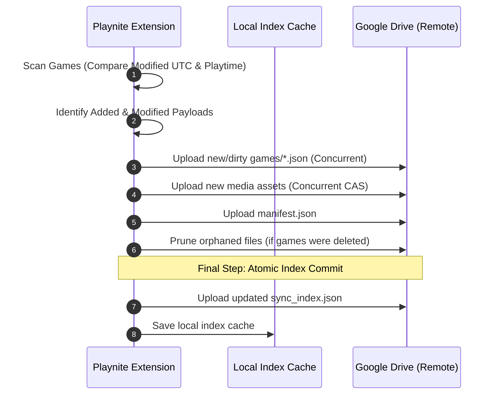

# Architecture & Delta-Sync Protocol Specification

This document details the architectural invariants, network protocols, data contracts, and storage schemas of **Playnite Mobile Delta Sync**.

---

## Table of Contents
1. [Core Design Principles](#1-core-design-principles)
2. [Data Storage Topology](#2-data-storage-topology)
3. [The Delta-Sync Protocol](#3-the-delta-sync-protocol)
   - [Desktop Push: Two-Phase Atomic Commit](#desktop-push-two-phase-atomic-commit)
   - [Mobile Pull: O(Delta) Network Efficiency](#mobile-pull-odelta-network-efficiency)
4. [Supported Playnite Addons & Extraction Pipeline](#4-supported-playnite-addons--extraction-pipeline)
5. [Deterministic Serialization & Hashing](#5-deterministic-serialization--hashing)
6. [Mobile Storage & SQLite Schema](#6-mobile-storage--sqlite-schema)

---

## 1. Core Design Principles

1. **Strict $O(\Delta)$ Efficiency:** Modifying a single game's playtime or closing a session touches **only** that game's JSON payload (`games/{game_id}.json`) and the central `sync_index.json`. A 2,000-game library syncs in under 2 seconds.
2. **Read-Only Non-Invasive Scope:** The mobile companion is strictly a viewer, tracker, and statistics dashboard. It contains no game launchers, no execution binaries, and does not require direct store logins.
3. **Least-Privilege Security:** Cloud sync uses Google's `drive.file` OAuth scope, restricting all access strictly to the dedicated application directory (`PlayniteSync`).
4. **Dynamic Addon Fault-Tolerance:** Whitelisted Playnite addons are extracted inside isolated try-catch error boundaries. Missing, disabled, or corrupted addons degrade gracefully without failing library export.
5. **Offline-First:** All metadata and cached media are stored in local SQLite storage on the mobile device, providing instant offline querying.

---

## 2. Data Storage Topology

Both Google Drive and Local Folder sync backends maintain an identical directory structure:

```text
PlayniteSync/
|-- manifest.json                 # Global library summary, taxonomy tables (platforms, genres, sources, tags)
|-- sync_index.json               # Authoritative manifest: relative paths, SHA-256 hashes, sizes, file IDs
|-- games/
|   |-- {game_guid_1}.json        # Unified per-game payload (core metadata + normalized addon stats)
|   |-- {game_guid_2}.json
|   +-- ...
+-- media/
    |-- covers/
    |   |-- {sha256_hash}.webp    # Content-Addressable Storage (CAS) cover images
    |   +-- ...
    |-- backgrounds/
    |   |-- {sha256_hash}.webp    # CAS background wallpapers
    |   +-- ...
    |-- logos/
    |   |-- {game_guid}.png       # Transparent game logo art
    |   +-- ...
    +-- microtrailers/
        |-- {game_guid}.mp4       # Lightweight looping video trailers
        +-- ...
```

---

## 3. The Delta-Sync Protocol

### Desktop Push: Two-Phase Atomic Commit
To guarantee that the remote library is never left in an inconsistent state if a network interruption occurs:



1. **Dirty Identification:** In-memory comparison against `sync_index.json` detects modified games based on `Game.Modified`, `Game.Playtime`, `Game.PlayCount`, and media file hashes.
2. **Payload Upload:** Changed game payloads and new media assets are uploaded concurrently with semaphore-controlled rate limiting.
3. **Atomic Commit:** `sync_index.json` is updated and uploaded as the **very last step**. If the network disconnects halfway through, the mobile app never sees a corrupt library because `sync_index.json` still points to valid files.

---

### Mobile Pull: $O(\Delta)$ Network Efficiency
When the mobile companion triggers a synchronization:

1. **Index Fetch:** The client requests `sync_index.json` (~95 KB for 1,500 games).
2. **Local Diffing:** The client compares remote `IndexEntry` records against local SQLite sync metadata (`SyncEntriesTable`).
3. **Targeted Fetch:** The client downloads **only** modified or added `games/{game_id}.json` files and newly discovered cover art.
4. **Atomic Transaction:** Ingested payloads are committed into SQLite inside an atomic database transaction. If an error occurs, the transaction rolls back cleanly.

---

## 4. Supported Playnite Addons & Extraction Pipeline

The desktop plugin integrates with popular Playnite addons using a whitelist architecture:

| Addon | Data Extracted | Mobile Section |
| :--- | :--- | :--- |
| **SuccessStory** | Unlocked/locked achievements, gamer score, unlock dates, achievement icons | Achievements Card & Tab |
| **HowLongToBeat** | Main Story, Main+Extra, and Completionist times (stored in seconds) | Time to Beat Cards |
| **GameActivity** | Itemized play sessions, duration per session, play dates | Session Timeline Graph |
| **ExtraMetadataLoader** | Logos (`Logo.png`), Micro-trailers (`VideoMicrotrailer.mp4`), Full Trailers | Hero Video Player & Logos |
| **CheckDlc** | DLC titles, store links, ownership flags | DLC Section |
| **SystemChecker** | Minimum / recommended hardware requirements | System Requirements Card |
| **SteamReviews** | Community review ratings, positive percentage | Review Score Badges |
| **SteamScreenshots** | High-resolution user screenshot URLs | Media Gallery Drawer |

### Dynamic Addon Extensibility
If an addon is not installed or has no data for a game:
- The exporter extracts `null` for that addon key.
- The mobile app's `AddonSectionRegistry` simply skips rendering that card.
- Unknown future addons are rendered gracefully by a fallback generic viewer without schema modifications.

---

## 5. Deterministic Serialization & Hashing

To guarantee consistent SHA-256 hashes across different operating system locales and platforms:
- **Key Sorting:** JSON object keys are strictly sorted in lexicographical order (ASCII ordinal).
- **ISO-8601 Timestamps:** All dates are formatted in UTC ISO-8601 format (`yyyy-MM-ddTHH:mm:ssZ`).
- **Culture Invariance:** Numeric and floating-point values are parsed using `CultureInfo.InvariantCulture`.
- **Content-Addressable Storage (CAS):** Image files are hashed with SHA-256 before storage. Identical images share the same filename (`media/covers/{sha256}.webp`), completely eliminating redundant duplicate uploads.

---

## 6. Mobile Storage & SQLite Schema

The Flutter Companion utilizes an SQLite database (managed via `sqflite` on mobile and `sqflite_common_ffi` on desktop/tests):

- **`games`:** Primary metadata table (Id, Name, SortingName, Playtime, PlayCount, LastPlayed, Added, Modified, ReleaseDate, Scores, PlatformIds, GenreIds, SourceId, CoverPath, BackgroundPath, LogoPath, MicrotrailerPath, and raw `addons_json`).
- **`manifest_meta`:** Library-wide key-value storage and taxonomy tables (Platforms, Genres, Sources, Categories, Tags).
- **`sync_entries`:** Local replica of the remote `sync_index.json` storing file paths, SHA-256 hashes, sizes, and cloud file IDs.
- **`games_fts`:** FTS5 full-text search virtual table enabling instant multi-keyword searching across titles, developers, publishers, and tags.
