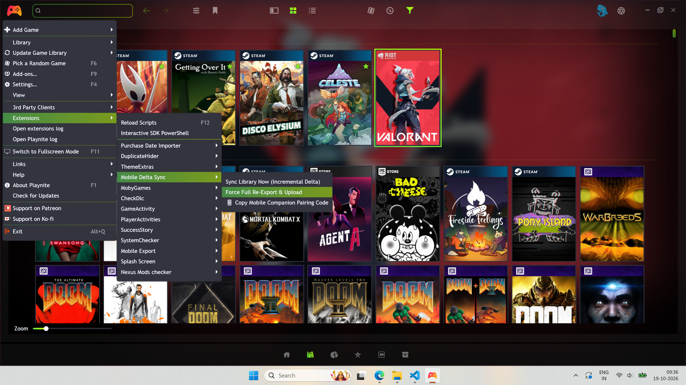
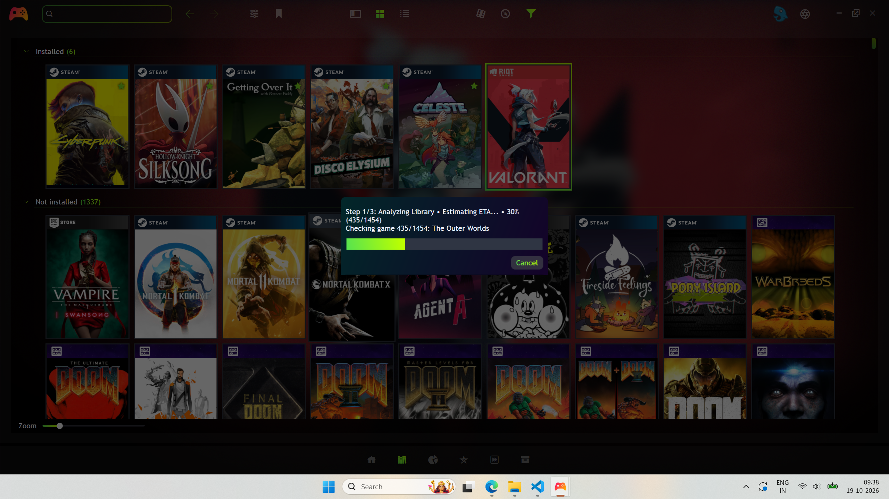
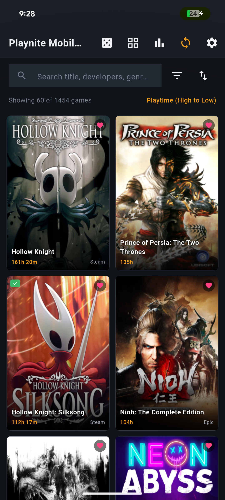
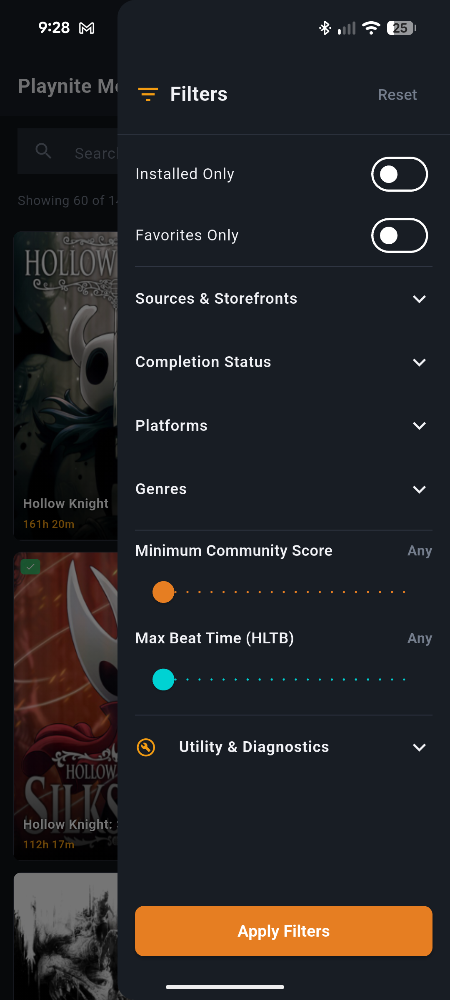
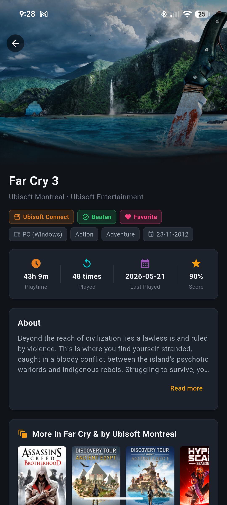
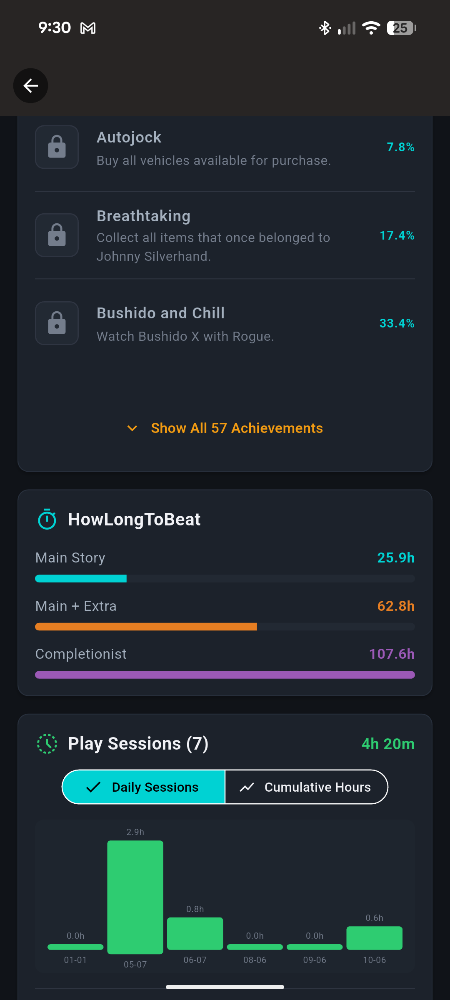
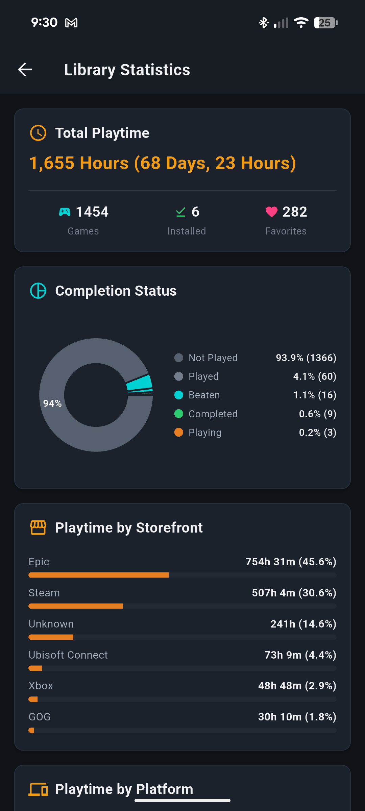
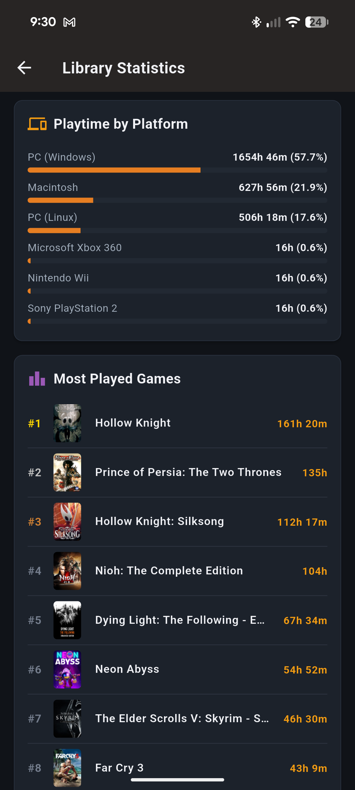

# Installation & Usage Guide

This guide covers installing and running both the **Playnite Desktop Exporter Addon** and the **Flutter Mobile Companion App**.

---

## Table of Contents
1. [Installing the Playnite Desktop Extension](#1-installing-the-playnite-desktop-extension)
2. [Configuring & Running the Desktop Addon](#2-configuring--running-the-desktop-addon)
   - [Initial Full Export](#initial-full-export)
   - [Automated Background Delta-Sync](#automated-background-delta-sync)
   - [Single-Game Manual Sync](#single-game-manual-sync)
3. [Installing the Mobile Companion App](#3-installing-the-mobile-companion-app)
4. [Using the Mobile Companion App](#4-using-the-mobile-companion-app)
   - [First-Time Sync](#first-time-sync)
   - [Instant Search & Multi-Criteria Filtering](#instant-search--multi-criteria-filtering)
   - [Rich Game Details & Addon Views](#rich-game-details--addon-views)
   - [Global Statistics Dashboard](#global-statistics-dashboard)
   - [Offline Mode & Demo Library](#offline-mode--demo-library)

---

## 1. Installing the Playnite Desktop Extension

You can install the compiled `.pext` package using any of the following methods:

### Method A: Direct Double-Click (Easiest)
1. Ensure Playnite is installed.
2. Double-click [**`dist/MobileDeltaSyncExporter.pext`**](file:///C:/Users/adith/Documents/Code/Playnite_Addon/dist/MobileDeltaSyncExporter.pext).
3. Playnite will display an extension installation confirmation dialog.
4. Click **Install**.
5. Restart Playnite when prompted.

### Method B: Drag & Drop
1. Open Playnite on your desktop.
2. Drag `dist/MobileDeltaSyncExporter.pext` from File Explorer and drop it onto the Playnite window.
3. Click **Install** and restart Playnite.

### Method C: Manual Drop-In
1. Extract the contents of `dist/MobileDeltaSyncExporter.pext` (or `playnite-exporter-plugin/bin/Release/net462/`) into:
   ```text
   %AppData%\Playnite\Extensions\MobileDeltaSyncExporter\
   ```
2. Restart Playnite.

To verify installation, open Playnite and look for the menu item **Main Menu > @Mobile Delta Sync**.

---

## 2. Configuring & Running the Desktop Addon

### Initial Full Export
Before mobile synchronization can occur, run an initial export to build the cloud snapshot:

1. In Playnite, navigate to **Main Menu > Settings > Add-ons > Extension Settings > Mobile Delta Sync**.
2. Configure your storage backend (see the [Setup & Auth Guide](setup-and-auth.md) for Google Drive or Local Folder details).
3. Open the top-left menu: **Main Menu > @Mobile Delta Sync > Force Full Re-Export & Upload**.
4. A progress dialog will appear with a live progress bar, completion percentage, and estimated time remaining (ETA):
   ```text
   ETA: 1m 24s • 45% (450/1000)
   Uploading game 450/800: Cyberpunk 2077 (450/1000)
   ```
5. When complete, a notification will confirm that all games, metadata, and media have been committed.

<p align="center">
  
  <br />
  <em>Triggering Initial Export from Playnite Main Menu</em>
</p>

<p align="center">
  
  <br />
  <em>Real-time Progress Bar & ETA</em>
</p>

---

### Automated Background Delta-Sync
Once the initial export is committed, you **do not need to manually trigger exports**:

- **On Game Exit (`OnGameStopped`):** As soon as you exit a game, the extension automatically extracts updated playtime, last played timestamps, achievements, and play sessions, uploading **only** that specific game's JSON (`games/{game_id}.json`) and committing `sync_index.json` without touching unchanged games.
- **On Library Update (`OnLibraryUpdated`):** When Playnite scans or modifies library items, the extension checks for changes and syncs only dirty games and new media.
- **Orphan Pruning:** When you delete a game from Playnite, the remote game JSON is automatically deleted from Google Drive.

---

### Single-Game Manual Sync
To manually sync an individual game at any time:
- Right-click any game in your Playnite library.
- Select **Sync this game to Mobile Cloud**.

---

## 3. Installing the Mobile Companion App

The Flutter Mobile Companion is distributed as an Android APK.

### Option A: Install via ADB (Android Debug Bridge)
Connect your Android device via USB with USB Debugging enabled, and run:
```powershell
adb install dist/playnite-mobile-companion.apk
```

### Option B: Direct File Transfer
1. Copy `dist/playnite-mobile-companion.apk` to your phone via USB cable, Google Drive, or local file sharing.
2. Open the file on your device using a File Manager.
3. If prompted, allow "Install unknown apps" for your file manager.
4. Tap **Install**.

---

## 4. Using the Mobile Companion App

### First-Time Sync
1. Open **Playnite Companion** on your phone.
2. Tap the **Sync** icon or the **Configure Sync** button.
3. Configure your connection (Google Drive or Local Folder) as detailed in the [Setup & Auth Guide](setup-and-auth.md).
4. Tap **Run Delta Sync Now**.
5. The sync manager fetches `sync_index.json` (~95 KB), identifies any changed games, downloads payloads, and stores everything in the local SQLite database.

---

### Instant Search & Multi-Criteria Filtering
- **High-FPS Grid / List / Compact Views:** Toggle between card grid, detailed list, or compact row views using the view switcher in the top bar.
- **Instant Search:** Type any game title, publisher, developer, or tag into the search bar. Searches run locally against indexed SQLite fields with sub-millisecond response times.
- **Filter Drawer:** Tap the filter icon to filter by:
  - Platform (PC, PlayStation, Nintendo Switch, etc.)
  - Source (Steam, GOG, Epic Games, Xbox, etc.)
  - Completion Status (Playing, Beaten, Completed, Plan to Play, Abandoned)
  - Genre & Tags
  - Critic & Community Score Ranges

| Library Grid View | Multi-Criteria Filter Drawer |
|:---:|:---:|
|  |  |

---

### Rich Game Details & Addon Views
Tapping any game opens the Game Detail Screen:
- **Hero Header:** Displays high-resolution cover art, transparent game logos, and background art.
- **Looping Micro-Trailers:** Plays lightweight micro-trailers extracted by `ExtraMetadataLoader`.
- **Addon Tabs:**
  - **Achievements (SuccessStory):** View unlocked vs locked achievements with gamer score, unlock timestamps, and icons.
  - **Time to Beat (HowLongToBeat):** Main Story, Main + Extra, and Completionist times formatted in hours and minutes.
  - **Play Activity (GameActivity):** Itemized play session history with play durations and dates.
  - **DLC Listings (CheckDlc):** View owned and unowned downloadable content.
  - **Links:** Direct hyperlinks to Steam, IGDB, PCGamingWiki, and custom URLs.

| Hero Section & Micro-trailer | Addon Showcase (Achievements & HLTB) |
|:---:|:---:|
|  |  |

---

### Global Statistics Dashboard
Tap the **Stats** navigation tab to view aggregate statistics for your entire collection:
- Total game count and library size
- Total cumulative playtime (days, hours, minutes)
- Playtime breakdown by platform and launcher
- Completion status distribution donut chart
- Recent play activity timeline

| Total Playtime & Completion Rate | Playtime by Platform & Most Played |
|:---:|:---:|
|  |  |

---

### Offline Mode & Demo Library
- **100% Offline Capability:** Because the entire library and cached media reside in local SQLite storage, the companion app works seamlessly on airplanes, subways, or when disconnected from Wi-Fi.
- **Demo Library:** If you want to explore the app without setting up Google Drive credentials, open **Sync Settings** and tap **Load Demo Library**. The app instantly populates a rich sample catalog featuring games like *Cyberpunk 2077*, *The Witcher 3*, and *Hades*.
