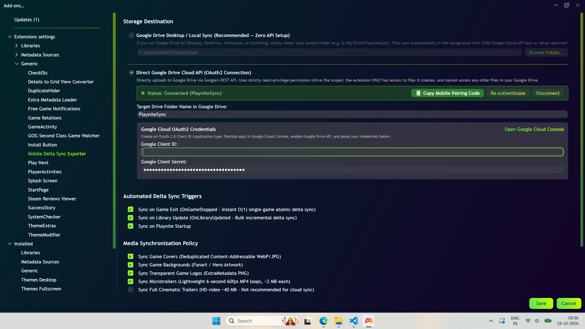
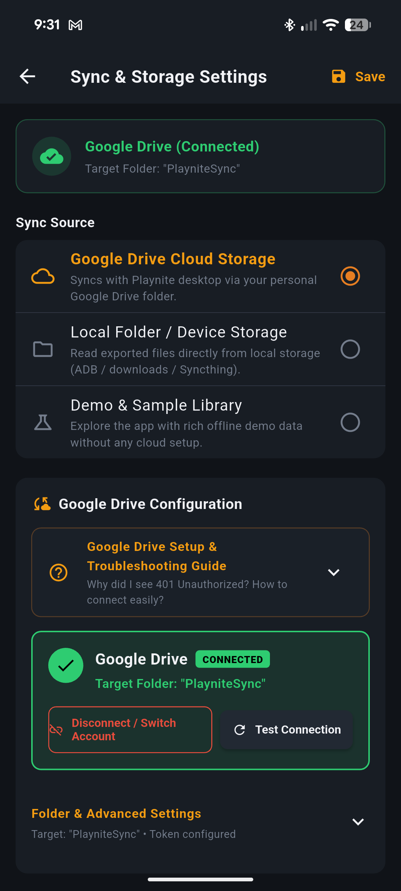

# Google Cloud Platform & Storage Setup Guide

This guide walks you through setting up synchronization for **Playnite Mobile Delta Sync**. You can either use **Google Drive** for seamless cloud sync across all your devices, or **Local Folder Sync** (including Google Drive for Desktop) without needing any Google Cloud configuration.

---

## Table of Contents
1. [Google Drive Setup (Cloud Sync)](#1-google-drive-setup-cloud-sync)
   - [Step 1: Create a Google Cloud Project](#step-1-create-a-google-cloud-project)
   - [Step 2: Enable the Google Drive API](#step-2-enable-the-google-drive-api)
   - [Step 3: Configure the OAuth Consent Screen](#step-3-configure-the-oauth-consent-screen)
   - [Step 4: Create OAuth 2.0 Client Credentials](#step-4-create-oauth-20-client-credentials)
2. [Configuring the Playnite Desktop Addon](#2-configuring-the-playnite-desktop-addon)
3. [Configuring the Flutter Mobile Companion](#3-configuring-the-flutter-mobile-companion)
4. [Alternative: Local Folder Sync (No GCP Account Required)](#4-alternative-local-folder-sync-no-gcp-account-required)
5. [Security & Scopes FAQ](#5-security--scopes-faq)

---

## 1. Google Drive Setup (Cloud Sync)

### Step 1: Create a Google Cloud Project
1. Open the [Google Cloud Console](https://console.cloud.google.com/).
2. Sign in with your Google account.
3. In the top navigation bar, click the project dropdown and select **New Project**.
4. Set the project name (e.g., `Playnite Mobile Sync`) and click **Create**.
5. Ensure your newly created project is selected in the top bar.

---

### Step 2: Enable the Google Drive API
1. In the Google Cloud Console, navigate to **APIs & Services > Library** (or search for "Google Drive API" in the search box).
2. Click **Google Drive API**.
3. Click the blue **Enable** button.

---

### Step 3: Configure the OAuth Consent Screen
Google requires an OAuth consent screen to be defined before you can create OAuth client credentials:

1. In the left sidebar, navigate to **APIs & Services > OAuth consent screen**.
2. Select **External** as the User Type and click **Create**.
3. Fill in the required application details:
   - **App name:** `Playnite Mobile Sync`
   - **User support email:** Select your Google email address.
   - **Developer contact information:** Enter your Google email address.
   - Click **Save and Continue**.
4. **Scopes:**
   - Click **Add or Remove Scopes**.
   - Search for `drive.file` and check the box:
     ```text
     https://www.googleapis.com/auth/drive.file
     ```
     > [!IMPORTANT]
     > The `drive.file` scope is the **least-privilege scope**. It allows the addon and mobile app to view and manage **only** the files and folders created by this app (e.g. the `PlayniteSync` folder). It cannot see, read, or modify any other files in your personal Google Drive.
   - Click **Update** and then **Save and Continue**.
5. **Test Users:**
   - Because your app is in "Testing" mode, Google requires you to explicitly whitelist your Google account.
   - Click **+ Add Users** and enter your personal Google email address.
   - Click **Add**, then click **Save and Continue**.
6. Review the summary and click **Back to Dashboard**.

---

### Step 4: Create OAuth 2.0 Client Credentials

You need an OAuth Client ID to allow the Desktop Addon and Mobile App to authenticate:

1. In the left sidebar, navigate to **APIs & Services > Credentials**.
2. Click **+ Create Credentials** at the top and select **OAuth client ID**.
3. In the **Application type** dropdown, select **Desktop app**.
4. Name it `Playnite Desktop & Mobile Client` and click **Create**.
5. A modal dialog will appear with:
   - **Client ID** (e.g., `1234567890-abcdefg123456.apps.googleusercontent.com`)
   - **Client Secret** (e.g., `GOCSPX-abc123def456...`)
6. Copy both values. You will paste them into the Playnite Addon settings.

---

## 2. Configuring the Playnite Desktop Addon

1. Open **Playnite**.
2. Go to **Main Menu (top left) > Settings > Add-ons > Extension Settings > Mobile Delta Sync**.
3. Select **Google Drive** under **Sync Storage Provider**.
4. Paste your **Google Client ID** and **Google Client Secret** into the respective fields.
5. (Optional) Set the **Google Drive Folder Name** (default is `PlayniteSync`).
6. Click **Connect Google Drive Account**:
   - A local loopback listener will open your default browser to Google's sign-in page.
   - Choose your whitelisted Google account.
   - Google may show an "App isn't verified" alert (this is normal for personal developer projects). Click **Advanced > Go to Playnite Mobile Sync (unsafe)**.
   - Click **Continue** to grant access to the `drive.file` scope.
7. Return to Playnite. The status will immediately turn green:
   ```text
   Status: Connected (PlayniteSync)
   ```
8. Click **Save** to persist your settings.

<p align="center">
  
</p>

---

## 3. Configuring the Flutter Mobile Companion

You can connect the mobile app to the same Google Drive folder using either of the following methods:

### Method A: Client ID + Browser Sign-In (Recommended)
1. Launch the **Playnite Companion** app on your Android device.
2. Tap the **Settings** gear icon in the top right corner.
3. Under **Sync Storage Backend**, select **Google Drive**.
4. Paste your **Google Client ID** into the **Google Client ID** input field.
5. Tap **Sign In via Browser**:
   - An in-app browser opens the Google authorization flow.
   - Sign in with your whitelisted Google account and grant folder permissions.
6. Once returned, tap **Run Delta Sync Now**. Your games and media will synchronize.

<p align="center">
  
</p>

### Method B: QR / Pairing Payload from Desktop
1. In the Playnite Extension Settings, click **Copy Mobile Pairing Payload**.
2. On mobile, in Sync Settings, paste the payload into the **Pairing Code** field and tap **Apply Configuration**.

---

## 4. Alternative: Local Folder Sync (No GCP Account Required)

If you do not want to set up Google Cloud OAuth, you can use **Local Folder Sync**:

### Option 1: Direct Local / LAN Network Share
1. In Playnite Addon Settings, select **Local Folder Staging**.
2. Set the destination path to a local directory (e.g., `D:\PlayniteMobileData`) or a local SMB network share.
3. Point your mobile companion to the same directory (via file transfer, Syncthing, or local network share).

### Option 2: Google Drive for Desktop
1. Install [Google Drive for Desktop](https://www.google.com/drive/download/) on your Windows PC. It mounts your Google Drive as a virtual drive letter (e.g., `G:\My Drive\`).
2. In Playnite Addon Settings, choose **Local Folder Staging**.
3. Set the path to `G:\My Drive\PlayniteSync`.
4. Windows will automatically sync all files to Google Drive in the background using the native desktop client!

---

## 5. Security & Scopes FAQ

### Is my personal Google Drive data accessible?
**No.** The app strictly requests `https://www.googleapis.com/auth/drive.file`. Google's security model guarantees that applications using this scope can **only access files that the app itself created**. It cannot see your Google Docs, Photos, or personal folders.

### Are my credentials shared or uploaded anywhere?
**No.** 
- All communication is direct between your PC/phone and Google's official REST API endpoints (`https://www.googleapis.com/drive/v3/`).
- The desktop extension stores OAuth refresh tokens locally using the **Windows Data Protection API (DPAPI)** with current-user encryption.
- No third-party intermediary servers, proxies, or analytics trackers are used.
