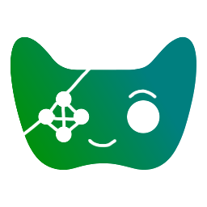

<p align="center">
  
</p>

# Playnite Mobile Companion

The official Flutter mobile companion application for **[Playnite](https://github.com/JosefNemec/Playnite)** ([playnite.link](https://playnite.link/)). Connects your desktop PC video game library to your Android device with an offline-first architecture, local SQLite database, fast fuzzy search, video micro-trailers, achievement browsers, and playtime analytics.

---

## Key Features

- **Offline-First Library:** Synchronizes delta metadata and media assets into a local SQLite database (`sqflite`). Once synced, browse your library with zero network connectivity.
- **Instant Multi-Criteria Search & Filtering:** Three-tier fuzzy search engine with exact match prioritization, multi-word token conjunction, and Levenshtein typo tolerance. Filter by platform, genre, source, completion status, tags, and user ratings.
- **Rich Addon Support:** Relational views for PlayniteAchievements / SuccessStory, HowLongToBeat completion estimates, GameActivity session timelines, CheckDlc listings, and Steam community review scores.
- **Media & Micro-Trailers:** Hero headers with transparent logos, screenshot galleries, and auto-looping video micro-trailers (with video priority controls in Settings).
- **Global Statistics Dashboard:** Comprehensive overview tab, platform breakdowns, playtime histograms with 7D/30D/All range chips, and a Global Achievements Browser.
- **Storage Independence:** Connects directly to Google Drive (via least-privilege `drive.file` scope) or local folders / Syncthing (with Android 11-16 `MANAGE_EXTERNAL_STORAGE` support).
- **Built-in Demo Mode:** Ships with an embedded mock library for instant testing and evaluation without cloud credentials.

---

## Architecture Overview

```text
lib/
|-- main.dart                     # App entry point, service locator, and route definitions
|-- core/
|   |-- constants/                # Theme colors, layout dimensions, asset paths
|   |-- database/                 # AppDatabase, SQLite schema, migrations & GameDao
|   |-- models/                   # Immutable domain models (Game, Media, Addon data)
|   |-- services/                 # Remote storage seam (DriveApiService), cache & media resolvers
|   |-- theme/                    # High-contrast dark gaming theme definitions
|   +-- utils/                    # FuzzySearchEngine, date formatters, and platform utilities
+-- features/
    |-- library/                  # Virtualized Grid/List views, catalog streams & filter drawer
    |-- game_detail/              # Hero header, micro-trailer player, achievement & HLTB cards
    |-- stats/                    # Global statistics dashboard, activity charts & achievement browser
    |-- settings/                 # Gallery preferences, rating sources, video playback priority
    +-- sync/                     # DeltaPullManager, Google Drive OAuth & Local Folder sync UI
```

---

## Development & Testing

### Prerequisites
- Flutter SDK `3.22+` (Dart `3.4+`)
- Android SDK (API 34) & JDK 17

### Running the App
```bash
# Get dependencies
flutter pub get

# Run on connected Android device / emulator
flutter run
```

### Static Analysis & Tests
```bash
# Static analysis (must maintain 0 warnings/errors)
flutter analyze

# Run full Flutter automated test suite (225 tests)
flutter test
```

> [!IMPORTANT]
> **Widget Test Invariant:** Any widget test mounting `LibraryScreen` or screens with active database subscriptions must pump `const SizedBox.shrink()` before teardown to unmount cleanly before closing the database:
> ```dart
> await tester.pumpWidget(const SizedBox.shrink());
> await tester.pump();
> ```

---

## Building Release APK

To compile the release APK locally:
```bash
flutter build apk --release
```
The compiled output is placed at `build/app/outputs/flutter-apk/app-release.apk`.
Alternatively, run `powershell -File ../scripts/package_dist.ps1` from the repository root to package both the desktop `.pext` and mobile `.apk` artifacts.
